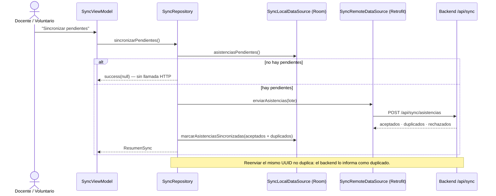

# Arquitectura — SyncPass (App Android)

> Documento vivo. Los diagramas son Mermaid. Las afirmaciones sobre la nube se basan
> en el código y los scripts del repositorio backend (`monolito_backend_syncpass`);
> la disponibilidad actual de Supabase/AWS EC2 se comprueba al desplegar (ver §6).

## 1. Contexto (C1)

```mermaid
flowchart LR
    Estudiante[Estudiante]
    Docente[Docente]
    Voluntario[Voluntario]
    Admin[Administrador]
    App[App SyncPass (Android, Kotlin)]
    Backend[API SyncPass (Spring Boot en AWS EC2)]
    Cognito[AWS Cognito (identidad y grupos)]
    Supabase[(Supabase / PostgreSQL)]
    Ntfy[ntfy (notificaciones push)]
    FCM[Firebase Cloud Messaging]

    Estudiante --> App
    Docente --> App
    Voluntario --> App
    Admin --> App
    App -->|HTTPS /api/*| Backend
    Backend -->|login InitiateAuth + JWKS| Cognito
    Backend -->|JDBC / Flyway| Supabase
    Backend -->|push a dispositivos registrados| FCM
    Admin -->|publica en el tópico (curl)| Ntfy
    App -->|escucha SSE del tópico del usuario| Ntfy
```

**Actores y servicios externos:**
- **Estudiante, Docente, Voluntario y Administrador:** los cuatro perfiles de la rúbrica (ver §3.3 para su equivalencia con los grupos de Cognito).
- **AWS Cognito:** gestiona credenciales y emite el access token con los grupos `ADMINISTRADOR`, `COORDINADOR`, `VOLUNTARIO`, `BENEFICIARIO`. **La app no llama a Cognito directamente:** el login pasa por el backend (`POST /api/auth/login`), que hace `InitiateAuth` y devuelve el token.
- **AWS EC2 + Spring Boot:** API REST tras nginx (reverse proxy + HTTPS). **No hay AWS API Gateway desplegado** (es opcional en la rúbrica); nginx cumple el rol de proxy.
- **Vercel (proxy):** el front y la app móvil llaman a `https://fullstack2-proyecto-kt.vercel.app/api/*`, que Vercel reenvía a EC2. Así los clientes no dependen directamente de `syncpass.duckdns.org` (bloqueado por FortiGuard en redes corporativas).
- **Supabase (PostgreSQL):** base de datos relacional del backend (Session Pooler, región us-east-2). ✅ Verificado.
- **ntfy:** la app escucha por SSE un tópico derivado del email (`NtfyTopics`). Los mensajes se publican directo en ntfy (por ejemplo con `curl`); el backend SyncPass **no** publica en ntfy. Ver `NOTIFICACIONES_NTFY.md`.
- **FCM:** el backend tiene un módulo de notificaciones (`/api/notifications`, envío por FCM), pero la app aún no integra Firebase, así que hoy no recibe esos push (backlog).

## 2. Contenedores (C2)

```mermaid
flowchart LR
    subgraph Dispositivo
        App[App Android\n(Kotlin, Compose, Hilt)]
        Room[(Room / SQLite\noffline)]
        DS[(DataStore\nToken de sesión)]
    end
    subgraph Nube
        Nginx[nginx (EC2)]
        Spring[Spring Boot\n(JAR, systemd)]
        Cognito[AWS Cognito]
        Supa[(Supabase\nPostgreSQL)]
        Param[(AWS Parameter Store)]
    end

    App -->|HTTPS /api/sync/catalogo\n/api/sync/asistencias\n/api/sync/encuestas| Nginx
    App -->|POST /api/auth/login| Nginx
    Nginx --> Spring
    Spring -->|InitiateAuth / valida JWT con JWKS| Cognito
    Spring -->|JDBC + Flyway| Supa
    Spring -->|lee secretos| Param
    App -->|SesionLocalDataSource| DS
    App -->|Sync/Universidad LocalDataSource| Room
```

**Comunicación y flujo de datos** (la rúbrica sugiere `App → API Gateway → Cognito → EC2 → Supabase`; el flujo real usa nginx en lugar de API Gateway):
1. La app envía usuario y contraseña a `POST /api/auth/login`; el backend autentica contra Cognito y responde el access token y el usuario con su rol. La app guarda el token en DataStore.
2. `TokenInterceptor` (OkHttp) adjunta `Authorization: Bearer <token>` a cada request; Spring valida la firma con el JWKS de Cognito y autoriza por grupo.
3. El catálogo (`/api/sync/catalogo`) se descarga a Room para operar offline.
4. Las asistencias/encuestas se guardan en `asistencias_offline` / `encuestas_offline` con `sincronizado = false`.
5. Con conexión, el usuario pulsa **"Sincronizar pendientes"** (o la app reintenta sola al recuperar la red) y se envían lotes a `/api/sync/asistencias` y `/api/sync/encuestas`. El servidor responde aceptados/duplicados/rechazados e idempotencia por UUID.

## 3. Componentes (C3) — MVVM

```mermaid
flowchart TB
    subgraph View
        Screens[Screens (Compose)\nfeature/*/ui/*Screen]
        Components[Components\ncore/designsystem/components]
    end
    subgraph ViewModel
        VMs[ViewModels (@HiltViewModel, StateFlow)\nfeature/*/ui/*ViewModel]
    end
    subgraph Model
        Repo[Repositories\nSyncRepository · UniversidadRepository\nAuthRepository · NotificacionesRepository]
        DSrc[DataSources\ncore/datasource/local · core/datasource/remote]
        Local[Local: Room DAOs · DataStore]
        Remote[Remote: Retrofit APIs]
    end
    Screens --> Components
    Screens --> VMs
    VMs --> Repo
    Repo --> DSrc
    DSrc --> Local
    DSrc --> Remote
```

### 3.1 Capas reales del proyecto

| Capa | Paquete | Clases |
|---|---|---|
| View — Screens | `feature/*/ui` | `LoginScreen`, `RegisterScreen`, `TeacherHomeScreen`, `SessionScreen`, `SessionDetailScreen`, `SessionEditScreen`, `StudentHomeScreen`, `StudentQuestionnaireScreen`, `ProfileScreen`, `DialogRegistrarAsistenciaOffline` |
| View — Components | `core/designsystem` | `PantallaBase`, `Tarjetas`, `Estados`, `QrComponents` (cámara/QR), tema |
| ViewModel | `feature/*/ui` | `LoginViewModel`, `SesionViewModel`, `RegisterViewModel`, `TeacherHomeViewModel`, `Session*ViewModel`, `Student*ViewModel`, `ProfileViewModel`, `SyncViewModel` |
| Model — Repository | `core/database/repository`, `feature/auth/data`, `feature/notificaciones/data` | `SyncRepository`, `UniversidadRepository`, `AuthRepository`, `NotificacionesRepository` |
| Model — Datasource | `core/datasource/local`, `core/datasource/remote` | `SyncLocalDataSource`, `UniversidadLocalDataSource`, `SesionLocalDataSource`, `SyncRemoteDataSource`, `AuthRemoteDataSource` |
| Model — Local | `core/database/local`, `core/datastore` | Room: `AppDatabase`, `SyncPassDao`, `UniversidadDao`, entidades · DataStore: `TokenDataStore` |
| Model — Remote | `core/network/remote` | Retrofit: `AuthApi`, `SyncApi`, `EventoApi`, `UsuarioApi`, DTOs; `TokenInterceptor`, `TokenAuthenticator` |
| Inyección | `*/di`, módulos Hilt | `DatabaseModule`, `NetworkModule`, `DataStoreModule`, `SesionDataSourceModule`, `NotificacionesModule` |

### 3.2 Reglas que cumple el código (verificables con `grep`)
- **Las Screens** no llaman Retrofit ni DAO: usan `hiltViewModel()` y `collectAsState()`.
- **Los ViewModels dependen solo de repositorios** (y de `SavedStateHandle` para los argumentos de navegación). Ninguno importa un DAO, una API de Retrofit, DataStore ni `Context`.
- **Los repositorios no conocen Room, Retrofit ni DataStore:** trabajan contra los datasources. `SyncRepository` coordina `SyncLocalDataSource` + `SyncRemoteDataSource` (offline-first); `AuthRepository` usa `AuthRemoteDataSource` + `SesionLocalDataSource`.
- **Solo los datasources** usan `SyncPassDao`, `UniversidadDao`, `AuthApi`, `SyncApi` y `TokenDataStore`. La excepción es la infraestructura HTTP (`TokenInterceptor`, `TokenAuthenticator`), que lee el token para armar cada request.
- **Notificaciones:** arrancar o detener el servicio en primer plano necesita un `Context`; eso vive en `NotificacionesRepositoryImpl`. Los ViewModels solo piden `activarPara(email)` / `desactivar()` a la interfaz `NotificacionesRepository`.
- **Lógica de negocio:** inscripción, presencia y cuestionario en `UniversidadRepository`; mapeo DTO ↔ entidad y marcado de sincronizados en `SyncRepository`; roles en `core/common/auth/Rol`.

### 3.3 Roles (rúbrica ↔ Cognito)

| Perfil (rúbrica) | Grupo Cognito | `Rol` en la app | Inicio |
|---|---|---|---|
| Estudiante | `BENEFICIARIO` | `Rol.ESTUDIANTE` | Inicio estudiante (`StudentHomeScreen`) |
| Docente | `COORDINADOR` | `Rol.DOCENTE` | Inicio docente (`TeacherHomeScreen`) |
| Voluntario | `VOLUNTARIO` | `Rol.VOLUNTARIO` | Inicio docente (registra asistencia y sincroniza) |
| Administrador | `ADMINISTRADOR` | `Rol.ADMINISTRADOR` | Inicio docente |

`Rol.desdeGrupos()` traduce los grupos del token (o el rol que devuelve el login) y `Rol.principal()` elige uno si hay varios (Administrador > Docente > Voluntario > Estudiante). Perfil muestra el perfil con el nombre de la rúbrica ("Rol: Voluntario"). La autorización real la hace el backend (`hasRole` por grupo).

### 3.4 Detalles conocidos (no bloqueantes)
- Hay dos modelos de datos: el **modelo SyncPass** (catálogo, asistencias y encuestas offline que se sincronizan con el backend) y el **modelo local de clases** (`Clase`/`Usuario`/`Rol` en Room, usado por las pantallas de clases y cuestionario), que solo vive en el teléfono.
- `SessionScreen`/`StudentHomeScreen` validan el QR en la propia Screen (mejorable).
- `TokenAuthenticator` **no** renueva tokens automáticamente: ante un 401 borra tokens y devuelve `null`.
- Room usa `fallbackToDestructiveMigration()`: un cambio de esquema borraría los pendientes no sincronizados. Antes de cambiar entidades hay que escribir migraciones explícitas.
- Hay dos paquetes de tema: `ui/theme` (usado por `MainActivity`) y `core/designsystem/theme`.

## 4. Flujos principales

### 4.1 Autenticación
1. `LoginViewModel` → `AuthRepository.login()` → `AuthRemoteDataSource` → `POST /api/auth/login` (el backend autentica contra Cognito).
2. `SesionLocalDataSource` guarda el token en DataStore; el rol sale del usuario que devuelve el backend o, si no viene, de `cognito:groups` del token.
3. Navegación por rol (§3.3) y `NotificacionesRepository.activarPara(email)`.
4. Al reabrir la app, `SesionViewModel` lee el token guardado, revisa su expiración y entra directo al inicio que corresponde; si no hay sesión válida, vuelve al login.

### 4.2 Offline-first (asistencias)
1. Desde Perfil, descargar catálogo (`/api/sync/catalogo`) → `SyncRemoteDataSource` → `SyncRepository` mapea → `SyncLocalDataSource` guarda en Room eventos y participantes.
2. Desde **"Registrar asistencia offline"**, elegir evento y participante del catálogo y guardar en `asistencias_offline` con UUID y `sincronizado = false`. Como no hay geolocalización se usa `estadoValidacion = SIN_UBICACION` y coordenadas nulas (valores permitidos por el backend).
3. El usuario puede pulsar **"Sincronizar pendientes"**; además, `SyncPassApplication` reintenta automáticamente cuando `ConnectivityManager.NetworkCallback` detecta una red con internet validado.
4. Se envían lotes a `/api/sync/asistencias` y `/api/sync/encuestas`. Los UUID aceptados y duplicados se marcan `sincronizado = true`; rechazados y errores de red permanecen pendientes para el siguiente intento.



### 4.3 Sincronización explícita + automática
La manual está en `feature/sync/ui/SyncViewModel` + sección "Sincronización" de `ProfileScreen`. La automática se registra en `SyncPassApplication`, sin duplicar sincronizaciones simultáneas en el proceso de la app. WorkManager queda como mejora futura para sincronizar también con la app cerrada.

## 5. APIs nativas utilizadas (≥2)
1. **Cámara + escaneo QR:** CameraX + ML Kit Barcode + ZXing (permiso `CAMERA`, solicitud en runtime).
2. **Notificaciones + servicio en primer plano:** canales, `NotificationManager`, foreground service, SSE de ntfy, reconexión.
3. **Estado de red:** `ConnectivityManager.NetworkCallback` para reintentar la sincronización al recuperar internet.

> **Geolocalización NO está implementada.** Los campos `latitud`/`longitud`/`distanciaMetros` en DTOs/entidades no constituyen integración de geolocalización.

## 6. Estado de la nube (verificado 20-11-2026)
- ✅ Supabase: conexión OK (Session Pooler, región us-east-2). Flyway V1/V2/V3 aplicadas.
- ✅ EC2: Spring Boot corriendo (Java 21, Ubuntu 26.04). Health check UP.
- ✅ Nginx + HTTPS (Certbot): reverse proxy funcionando.
- ✅ Cognito: login real exitoso (BENEFICIARIO y COORDINADOR). Token JWT válido.
- ✅ Sync E2E: catálogo (3 proyectos, 6 eventos, 42 participantes, 116 inscripciones) + asistencia aceptada + idempotencia.
- ✅ CORS: `Access-Control-Allow-Origin: https://fullstack2-proyecto-kt.vercel.app`.
- ✅ Front en Vercel: `https://fullstack2-proyecto-kt.vercel.app` (HTTP 200, `/api` rewrite → EC2).
- No hay API Gateway desplegado (nginx cumple el rol de proxy).
- No hay endpoint de refresh de token.
- Notificaciones: historial devuelve `[]`; recordatorios pueden duplicarse; envío a todos los dispositivos activos.
- Datos semilla desactivados en producción (`SYNCPASS_DATOS_SEMILLA=false`).

## 7. Pruebas y cobertura
- 84 pruebas JVM (`app/src/test`) con *fakes* de DAOs, APIs, sesión y notificaciones (sin emulador): repositorios, datasources (a través de los repositorios), ViewModels (`Login`, `Sesion`, `Profile`, `Sync`, `TeacherHome`), roles, QR y navegación.
- Cobertura con el plugin `jacoco` de Gradle, portable (sin rutas absolutas):
  - `./gradlew jacocoTestReport` → `app/build/reports/jacoco/jacocoTestReport/html/index.html`
  - `./gradlew jacocoTestCoverageVerification` → falla si las líneas cubiertas bajan del 30 %.
- Resultado (19-11-2026): **50,0 % de líneas**, 44,7 % de instrucciones, 30,6 % de ramas.
- Se excluye código generado (Hilt, Room `*_Impl`, `BuildConfig`, `R`) y la UI de Compose (`*Screen*`, diálogos de `feature/*/ui`, `core/designsystem`, temas), que no es lógica de negocio testeable en la JVM. La lista comentada está en `app/build.gradle.kts`.
