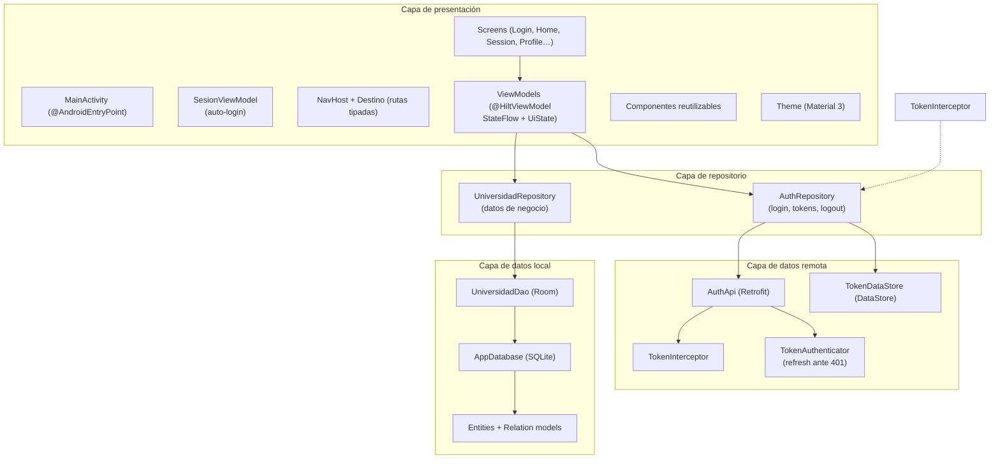
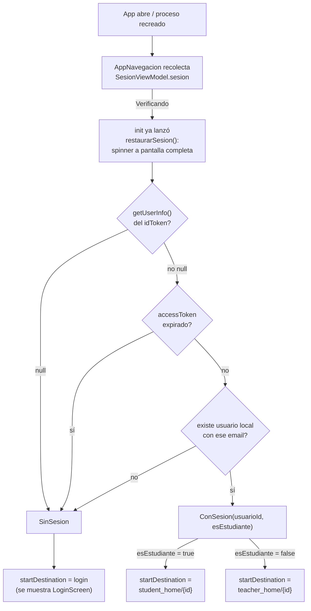
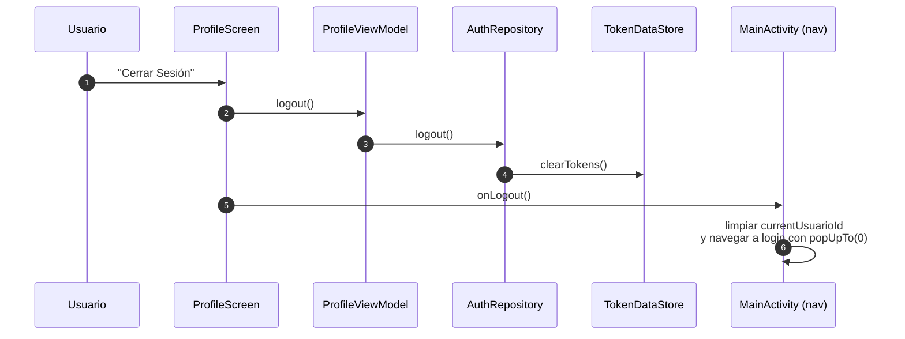

# Arquitectura de Disco

Documento de referencia para entender cómo está organizada la aplicación, qué
responsabilidad tiene cada capa, cómo fluyen los datos y por qué se eligió cada
tipo de Kotlin (`data class`, `sealed class`, `object`, etc.).

> **Alcance:** este documento describe el código tal como está hoy en
> `app/src/main/java/com/rojas/disco`. No es una arquitectura ideal teórica:
> documenta la implementación real, sus decisiones y su deuda técnica.

### Cómo leer este documento

- **Entender la organización general:** secciones 3 y 4.
- **Entender cómo se conectan UI, repositorio y base de datos local:** secciones 3 y 6.
- **Entender la autenticación contra la API (login, tokens, refresh):** sección 7.
- **Entender por qué se eligió cada tipo de Kotlin:** sección 8.
- **Agregar una pantalla o ruta nueva (tutorial paso a paso):** sección 14.1.
- **Llamar a la API desde una funcionalidad nueva:** sección 14.2.
- **Guardar datos localmente:** secciones 14.3 (Room) y 14.4 (DataStore).
- **Revisar limitaciones y próximos pasos:** sección 15.

---

## 1. Resumen de la aplicación

**Disco** es una aplicación Android nativa para gestionar clases universitarias,
asistencia y cuestionarios.

Roles funcionales:

- **Profesor:** crea clases, muestra el QR de una clase, escanea el QR de un
  estudiante para marcarlo presente y revisa asistencias/respuestas.
- **Estudiante:** se inscribe escaneando el QR de una clase, responde el
  cuestionario y muestra su QR personal para que el profesor lo marque presente.

Flujos principales:

1. Login contra la API remota (correo + contraseña, tokens JWT).
2. Listado de clases del profesor o del estudiante.
3. Detalle de clase, QR y asistencias.
4. Creación y edición de clases.
5. Registro de asistencia y respuestas de cuestionario.
6. Restauración automática de sesión al abrir la app (auto-login).

La aplicación es **local-first con autenticación remota**: el login se valida
contra una API (Retrofit) y los tokens se guardan en el dispositivo
(DataStore), pero toda la información de negocio (usuarios, clases,
asistencias, respuestas) vive en SQLite mediante Room. No hay sincronización
remota del contenido de negocio.

---

## 2. Stack tecnológico

| Tecnología | Versión / uso | Para qué se usa |
|---|---|---|
| Kotlin | 2.1.0 | Lenguaje principal. |
| Jetpack Compose | BOM `2026.02.01` | UI declarativa. |
| Material 3 | Incluido en el BOM | Componentes visuales y tema. |
| Navigation Compose | 2.8.8 | Navegación entre pantallas. |
| Room | 2.8.5 + KSP | Persistencia local SQLite y consultas reactivas. |
| Kotlin Coroutines / Flow | Incluido con Room/Compose | Operaciones asíncronas y observación de datos. |
| Retrofit + Gson | 2.11.0 | Llamadas HTTP declarativas a la API de autenticación. |
| OkHttp + logging-interceptor | 4.12.0 | Cliente HTTP, interceptores y autenticador de tokens. |
| DataStore Preferences | 1.1.1 | Almacenamiento persistente de tokens (`access`, `refresh`, `id`). |
| java-jwt (auth0) | 4.5.0 | Decodificar el `idToken` JWT para extraer usuario/roles. |
| CameraX | 1.4.1 | Vista previa de cámara. |
| ML Kit Barcode Scanning | 17.3.0 | Detección de códigos QR. |
| ZXing Core | 3.5.4 | Generación de imágenes QR. |
| Hilt | 2.55 | Inyección de dependencias. |
| Hilt Navigation Compose | 1.2.0 | Inyección de ViewModels en la navegación de Compose. |
| KSP | 2.1.0-1.0.29 | Generación de código de Room y Hilt. |
| Gradle + version catalog | `gradle/libs.versions.toml` | Dependencias centralizadas. |

Deuda de dependencias:

- Todas las dependencias declaradas en `app/build.gradle.kts` se usan hoy (no
  hay deps huérfanas). La URL de la API proviene de `BuildConfig.API_BASE_URL`
  (definida por `buildConfigField` en `app/build.gradle.kts`).

---

## 3. Vista general por capas

La app sigue una separación en capas con inyección de dependencias mediante Hilt:



En texto (equivale al diagrama):

```text
┌─────────────────────────────────────────────────────────────────────┐
│                         CAPA DE PRESENTACIÓN                        │
│                                                                     │
│  MainActivity (@AndroidEntryPoint)                                  │
│    ├── SesionViewModel: auto-login al iniciar                       │
│    ├── NavHost + Destino (rutas)                                    │
│    ├── Screens (Login, Home profesor/estudiante, Session, Profile…) │
│    ├── ViewModels (@HiltViewModel + StateFlow + UiState)            │
│    ├── Components reutilizables (tarjetas, estados, QR, scaffold)   │
│    └── Theme (Material 3)                                           │
└──────────────────┬──────────────────────────────┬───────────────────┘
                   │ StateFlow / suspend          │
                   ▼                              ▼
┌─────────────────────────────────┐  ┌─────────────────────────────────┐
│  CAPA DE REPOSITORIO (negocio)  │  │    CAPA DE REPOSITORIO (auth)   │
│                                 │  │                                 │
│  UniversidadRepository          │  │  AuthRepository                 │
│  (@Inject @Singleton)           │  │  (@ViewModelScoped)             │
│    ├── Flow para observables    │  │    ├── login(email, password)   │
│    └── suspend para escrituras  │  │    ├── logout / getUserInfo     │
│        + reglas de negocio      │  │    └── isTokenExpired           │
└────────────┬────────────────────┘  └──────────┬──────────────────────┘
             │ DAO (@Inject)                    │ Retrofit / DataStore
             ▼                                  ▼
┌─────────────────────────────────┐  ┌─────────────────────────────────┐
│      CAPA DE DATOS LOCAL        │  │       CAPA DE DATOS REMOTA      │
│                                 │  │                                 │
│  UniversidadDao (Room)          │  │  AuthApi (Retrofit)             │
│  AppDatabase / SQLite           │  │  OkHttpClient                   │
│  Entities + Relation models     │  │   ├── TokenInterceptor (Bearer) │
│  CodigoQr (formatos de QR)      │  │   └── TokenAuthenticator        │
│                                 │  │ TokenDataStore (DataStore)      │
│           SQLite                │  │  JWT decode (java-jwt)          │
└─────────────────────────────────┘  └─────────────────────────────────┘
```

### Dirección de las dependencias

- La UI conoce a los repositorios (`UniversidadRepository`, `AuthRepository`).
- Los repositorios conocen al DAO o a la API remota.
- Las capas inferiores **no** conocen Compose ni la UI.

Esto permite cambiar la fuente de datos (por ejemplo, sincronizar el contenido
de negocio con la API) sin tocar las pantallas, siempre que se mantenga la API
del repositorio.

### Sobre la capa de dominio

No existe un paquete `domain` separado. Las reglas de negocio actuales viven en
`UniversidadRepository`:

- Un profesor no puede inscribirse como estudiante de su propia clase.
- Solo se guardan respuestas si el estudiante está presente.
- La inscripción crea una asistencia inicial en `false`.

La lógica de autenticación vive en `AuthRepository` + `LoginViewModel`
(decidir el home según los roles del JWT, sincronizar el usuario en la base
local).

Si la app crece, esas reglas podrían extraerse a casos de uso (`UseCase`) o a
modelos de dominio, pero hoy el repositorio cumple ese rol sin complejidad
innecesaria.

---

## 4. Estructura de directorios

```text
Disco/
├── app/
│   ├── build.gradle.kts
│   └── src/
│       ├── main/
│       │   ├── AndroidManifest.xml
│       │   ├── java/com/rojas/disco/
│       │   │   ├── DiscoApplication.kt       (Anotada con @HiltAndroidApp)
│       │   │   ├── MainActivity.kt           (Anotada con @AndroidEntryPoint)
│       │   │   │
│       │   │   ├── di/                       (Módulos de Inyección de Dependencias)
│       │   │   │   ├── DatabaseModule.kt     (Provee AppDatabase y UniversidadDao)
│       │   │   │   └── NetworkModule.kt      (Provee OkHttpClient, Retrofit y AuthApi)
│       │   │   │
│       │   │   ├── data/
│       │   │   │   ├── CodigoQr.kt
│       │   │   │   ├── local/
│       │   │   │   │   ├── database/
│       │   │   │   │   │   ├── AppDatabase.kt
│       │   │   │   │   │   └── UniversidadDao.kt
│       │   │   │   │   ├── entities/
│       │   │   │   │   ├── model/
│       │   │   │   │   └── database/
│       │   │   │   ├── remote/
│       │   │   │   │   ├── AuthApi.kt        (endpoints login/refresh)
│       │   │   │   │   ├── TokenDataStore.kt (persistencia de tokens + UserInfo + DataStoreModule)
│       │   │   │   │   ├── TokenInterceptor.kt (agrega Authorization: Bearer)
│       │   │   │   │   ├── TokenAuthenticator.kt (refresh automático ante 401)
│       │   │   │   │   └── model/
│       │   │   │   │       ├── LoginRequest.kt
│       │   │   │   │       ├── LoginResponse.kt
│       │   │   │   │       └── RefreshTokenRequest.kt
│       │   │   │   └── repository/
│       │   │   │       ├── UniversidadRepository.kt (@Inject @Singleton)
│       │   │   │       └── AuthRepository.kt (@ViewModelScoped)
│       │   │   │
│       │   │   └── ui/
│       │   │       ├── navigation/
│       │   │       │   └── Destino.kt
│       │   │       ├── viewmodels/           (ViewModels con @HiltViewModel)
│       │   │       │   ├── LoginViewModel.kt
│       │   │       │   ├── SesionViewModel.kt   (auto-login)
│       │   │       │   ├── TeacherHomeViewModel.kt
│       │   │       │   ├── StudentHomeViewModel.kt
│       │   │       │   ├── SessionViewModel.kt
│       │   │       │   ├── SessionDetailViewModel.kt
│       │   │       │   ├── SessionEditViewModel.kt
│       │   │       │   ├── StudentQuestionnaireViewModel.kt
│       │   │       │   └── ProfileViewModel.kt
│       │   │       ├── screens/
│       │   │       │   ├── LoginScreen.kt
│       │   │       │   ├── TeacherHomeScreen.kt
│       │   │       │   ├── StudentHomeScreen.kt
│       │   │       │   ├── StudentQuestionnaireScreen.kt
│       │   │       │   ├── SessionScreen.kt
│       │   │       │   ├── SessionDetailScreen.kt
│       │   │       │   ├── SessionEditScreen.kt
│       │   │       │   └── ProfileScreen.kt
│       │   │       ├── components/
│       │   │       │   ├── PantallaBase.kt
│       │   │       │   ├── Tarjetas.kt
│       │   │       │   ├── Estados.kt
│       │   │       │   └── QrComponents.kt
│       │   │       └── theme/
│       │   │           ├── Color.kt
│       │   │           ├── Theme.kt
│       │   │           └── Type.kt
│       │   │
│       │   └── res/                  (íconos, temas XML, strings, backups)
│       │
│       ├── test/                     (tests JVM)
│       └── androidTest/              (tests instrumentados)
│
├── docs/
│   ├── ARQUITECTURA.md               (este documento)
│   ├── REQUERIMIENTOS.md
│   └── README.md
├── CHANGELOG.md
├── gradle/
│   └── libs.versions.toml
├── build.gradle.kts
├── settings.gradle.kts
├── gradle.properties
├── gradlew / gradlew.bat
└── local.properties                  (no versionado)
```

Entities (todas en `data/local/entities/`): `UsuarioEntity`, `RolEntity`,
`UsuarioRolCrossRef`, `ClaseEntity`, `AsistenciaClaseEntity`, y las entities
sin uso `CursoEntity`, `EstudianteEntity`, `EstudianteCursoCrossRef`.

Models (`data/local/model/`): `UsuarioConRoles`, `ClaseConDetalles`,
`RolConUsuarios`.

### Qué va en cada paquete

| Paquete | Responsabilidad | No debería contener |
|---|---|---|
| `com.rojas.disco` | Punto de entrada, sesión global y `NavHost`. | Lógica de negocio o consultas SQL. |
| `di` | Módulos Hilt (`DatabaseModule`, `NetworkModule`). | Lógica de negocio. |
| `data.local.entities` | Clases `@Entity` que representan tablas. | Lógica de UI o navegación. |
| `data.local.model` | Proyecciones de consulta con `@Embedded`/`@Relation`. | Tablas nuevas ni escrituras. |
| `data.local.database` | `@Database`, DAO e inicialización de Room. | Estado de Compose. |
| `data.remote` | Retrofit (`AuthApi`), tokens e interceptores. | Referencias a Compose o al DAO. |
| `data.remote.model` | DTOs de las llamadas HTTP (request/response). | Entidades Room. |
| `data.repository` | API de datos para la UI y reglas de negocio simples. | Referencias al `NavController` o a composables. |
| `data` | Tipos de datos transversales, como `CodigoQr`. | Persistencia. |
| `ui.navigation` | Rutas tipadas y helpers de navegación. | Pantallas concretas. |
| `ui.screens` | Una pantalla por archivo; consume su ViewModel. | Llamar a repositorios o DAOs directamente. |
| `ui.viewmodels` | Estado observable por pantalla + acciones. | Referencias a `NavController` o composables. |
| `ui.components` | UI reutilizable sin dependencia del repositorio. | Consultas a Room o llamadas HTTP. |
| `ui.theme` | Colores, tipografía y tema Material 3. | Lógica de negocio. |

---

## 5. Capa de presentación

### 5.1 `MainActivity`, auto-login e inyección con Hilt

`MainActivity` está anotada con `@AndroidEntryPoint`. `DiscoApplication`
(anotada con `@HiltAndroidApp`) sirve como contenedor raíz de dependencias.

`MainActivity` cumple las siguientes funciones:

1. Configurar Compose con el tema de la app (`DiscoTheme`).
2. Alojar el grafo de navegación (`NavHost` con Navigation Compose).
3. Decidir el destino inicial con el auto-login de `SesionViewModel`.

La composición está dividida en dos composables:

- `AppNavegacion`: recolecta el estado de `SesionViewModel` y, mientras la
  sesión se está verificando, muestra un `CircularProgressIndicator` a pantalla
  completa. Cuando el estado se resuelve, construye el `NavHost` con el
  `startDestination` correspondiente:

  - `SinSesion` → `Destino.Login.patron`;
  - `ConSesion(usuarioId, esEstudiante)` → `Destino.InicioProfesor.crearRuta(id)`
    o `Destino.InicioEstudiante.crearRuta(id)`, según el rol.

- `AppNavegacionInterna`: el `Scaffold` con la `NavigationBar` y el `NavHost`
  completo. Mantiene en memoria el estado de sesión UI:

  ```kotlin
  var currentUsuarioId by remember { mutableStateOf<Long?>(null) }
  var isEstudianteUser by remember { mutableStateOf(false) }
  ```

  Ese estado decide:

  - qué ítem de la barra inferior está seleccionado;
  - si se muestra o no la barra inferior;
  - a qué pestaña vuelve cada ítem.

**Nota de mitigación de limitación:** antes, la sesión se lostía si el proceso
se recreaba. Hoy `SesionViewModel` la restaura automáticamente desde los tokens
persistidos (ver sección 10.2), por lo que `currentUsuarioId` se vuelve a
poblar transitando por la pantalla inicial del home.

### 5.2 Navegación tipada: `ui/navigation/Destino.kt`

Todas las rutas están centralizadas en una `sealed class`:

```kotlin
sealed class Destino(
    val base: String,
    val argumentos: List<ArgumentoRuta> = emptyList()
) {
    data object Login : Destino("login")

    data object Sesion : Destino(
        base = "session",
        argumentos = listOf(ArgumentoRuta("claseId", NavType.LongType))
    ) {
        fun crearRuta(claseId: Long) = construirRuta(claseId)
        fun claseId(entry: NavBackStackEntry) = entry.long()
    }
}
```

Cada destino conoce:

- su segmento base (`session`);
- sus argumentos y sus tipos (`NavType.LongType`);
- cómo construir una ruta concreta (`crearRuta`);
- cómo leer sus argumentos desde el back stack (`claseId(entry)`).

El patrón se genera automáticamente:

```text
base = "session"
argumentos = ["claseId"]
patron = "session/{claseId}"
```

Y una ruta concreta se construye sin concatenar strings a mano:

```kotlin
Destino.Sesion.crearRuta(42L) // "session/42"
```

Para registrar destinos no se repite `route` ni `arguments`:

```kotlin
composableDestino(Destino.Sesion) { backStackEntry ->
    val claseId = Destino.Sesion.claseId(backStackEntry)
    SessionScreen(claseId = claseId, ...)
}
```

Para navegar:

```kotlin
navController.navegarA(Destino.Sesion, claseId)
navController.navegarAPestana(Destino.Perfil, usuarioId)
```

`navegarAPestana` concentra la configuración de la barra inferior:

```kotlin
popUpTo(graph.findStartDestination().id) { saveState = true }
launchSingleTop = true
restoreState = true
```

#### ¿Por qué se usa una `sealed class` para las rutas?

- **Conjunto cerrado:** solo existen los destinos declarados. El compilador
  conoce todos los casos.
- **Cada destino puede tener una forma distinta:** `Login` no tiene argumentos;
  `CuestionarioEstudiante` tiene dos; otros tienen uno. Una `enum` no modela
  bien esa diferencia.
- **Comportamiento por caso:** cada objeto puede exponer `crearRuta` y lectores
  tipados con nombres claros (`claseId`, `estudianteId`, `usuarioId`).
- **Sin strings sueltos:** el nombre de la ruta y de los argumentos vive en un
  único lugar.
- **Seguridad al refactorizar:** renombrar un destino o un argumento genera
  errores de compilación en los usos, no fallos silenciosos en tiempo de
  ejecución.

#### ¿Por qué `data object` y no `object`?

`data object` aporta una implementación de `toString()` más legible y mantiene
la semántica de objeto único. Se usa para destinos sin parámetros ni estado
(`Login`, `Sesion`, etc.). No se usa `data class` porque no hay instancias con
datos: el destino es un valor único del conjunto.

### 5.3 Pantallas: `ui/screens`

Cada archivo contiene una pantalla y, cuando hace falta, componentes privados o
específicos de esa pantalla.

Patrón general (la pantalla no llama a repositorios: consume su ViewModel):

```kotlin
@Composable
fun XScreen(
    viewModel: XViewModel = hiltViewModel(),
    onNavigateBack: () -> Unit
) {
    val uiState by viewModel.uiState.collectAsState()

    // UI declarativa con uiState
}
```

Responsabilidades de una pantalla:

- Colectar el `StateFlow` del ViewModel con `collectAsState`.
- Mantener estado efímero de UI (`remember`, `mutableStateOf`).
- Delegar acciones al ViewModel (`viewModel.crear(...)`).
- Recibir callbacks de navegación (`onNavigateBack`, `onLogin...`).
- Renderizar componentes reutilizables.

Lo que **no** debería hacer:

- Consultar Room ni llamar a la API directamente.
- Guardar estado global de sesión.
- Construir rutas con strings.

#### Estado y efectos

| Herramienta | Uso en el proyecto | Por qué |
|---|---|---|
| `remember` | Guardar estado local entre recomposiciones. | Evita recrear valores en cada recomposición. |
| `mutableStateOf` | Estado observable de la UI. | Compose recompone al cambiar. |
| `collectAsState` | Convertir un `StateFlow`/`Flow` en estado Compose. | Los cambios de datos recompone la UI sola. |
| `collectAsState` en `AppNavegacion` | Estado de la sesión de `SesionViewModel`. | Decide el destino inicial (auto-login). |

El estado se mantiene **lo más abajo posible** (en la pantalla que lo usa). Solo
el estado de sesión sube a `MainActivity` porque lo necesitan el `NavHost` y la
barra inferior.

### 5.4 Componentes reutilizables: `ui/components`

| Archivo | Contiene | Reutilizado en |
|---|---|---|
| `PantallaBase.kt` | `PantallaConBarraSuperior`: `Scaffold` + `TopAppBar` + botón volver. | Session, SessionDetail, SessionEdit, StudentQuestionnaire. |
| `Tarjetas.kt` | `TarjetaSeccion` (tarjeta con padding/color) y `TarjetaClase` (tarjeta clicable con encabezado y pie opcionales). | Varias pantallas y listados. |
| `Estados.kt` | `EstadoVacio` para listas sin datos, con acción opcional. | Home de profesor y estudiante. |
| `QrComponents.kt` | Generación de QR, diálogo para mostrarlo, cámara con CameraX/ML Kit y diálogo de escaneo. | Session, StudentHome, Profile. |

Estos componentes son **stateless** siempre que es posible: reciben datos y
callbacks, no acceden a repositorios ni ViewModels. Eso los hace fáciles de
reutilizar y de probar.

### 5.5 Tema: `ui/theme`

- `Color.kt`: paleta base.
- `Type.kt`: tipografía Material 3.
- `Theme.kt`: `DiscoTheme`, con soporte de modo oscuro y color dinámico en
  Android 12+.

`DiscoTheme` envuelve todo el contenido en `MaterialTheme`, de modo que las
pantallas usan `MaterialTheme.colorScheme` y `MaterialTheme.typography` en lugar
de colores/tamaños hardcodeados.

---

## 6. Capa de datos local (Room)

### 6.1 Repositorio

`UniversidadRepository` es la única puerta de entrada de la UI a los datos de
negocio.

Expone dos estilos de API:

```kotlin
// Observación reactiva: la UI se actualiza sola.
fun obtenerClasesPorProfesor(profesorId: Long): Flow<List<ClaseEntity>>

// Operación puntual: se espera el resultado.
suspend fun crearClase(clase: ClaseEntity): Long
```

Ventajas:

- La UI no conoce `UniversidadDao` ni Room.
- Las reglas de negocio tienen un lugar claro.
- Es fácil sustituir la fuente de datos o crear un fake para tests.

Reglas implementadas hoy:

```kotlin
// Un profesor no puede inscribirse como estudiante de su propia clase.
if (clase.profesorId == usuarioId) {
    throw IllegalArgumentException(...)
}

// Solo se guardan respuestas si el estudiante está presente.
val respuestasFinales = if (esPresente) respuestasJson else null
```

### 6.2 DAO

`UniversidadDao` es una **interface** anotada con `@Dao`. Room genera la
implementación en build time con KSP.

Métodos:

- `@Insert`, `@Update`, `@Delete`: escrituras.
- `@Query`: SQL explícito.
- `@Transaction` + `@Relation`: consultas con relaciones.
- `Flow<T>`: consultas observables.
- `suspend`: operaciones que no bloquean el hilo principal.

La interface permite:

- que Room genere la implementación;
- que el repositorio dependa de una abstracción;
- crear implementaciones falsas en tests sin base de datos real.

### 6.3 Base de datos

`AppDatabase` es una `abstract class` porque Room necesita heredar de
`RoomDatabase` y generar la implementación.

Registro de entidades:

```kotlin
@Database(
    entities = [
        UsuarioEntity::class,
        RolEntity::class,
        UsuarioRolCrossRef::class,
        ClaseEntity::class,
        AsistenciaClaseEntity::class
    ],
    version = 1
)
abstract class AppDatabase : RoomDatabase() {
    abstract fun universidadDao(): UniversidadDao
}
```

El singleton se implementa con `companion object`, `@Volatile` y
`synchronized(this)` (double-checked locking). Así se garantiza una sola
instancia de la base de datos en toda la app, incluso con acceso desde varios
hilos.

### 6.4 Entidades y modelo relacional

```text
usuarios
  usuarioId (PK)
  nombre
  email
      │ 1
      │
      │ N
clases
  claseId (PK)
  nombre
  descripcion
  profesorId (FK -> usuarios.usuarioId, RESTRICT)
  cuestionarioEstructuraJson
      │ 1
      │
      │ N
asistencia_clase
  usuarioId (PK, FK -> usuarios.usuarioId, CASCADE)
  claseId   (PK, FK -> clases.claseId, CASCADE)
  esPresente
  respuestasCuestionarioJson

usuarios N ─── N roles
        mediante usuario_rol_cross_ref
        (usuarioId, rolId) PK compuesta
```

Decisiones importantes:

- **`asistencia_clase` es la tabla intermedia N:M** entre usuarios y clases.
  Además de relacionar, guarda estado propio: `esPresente` y las respuestas.
  Por eso no es una simple cross-ref.
- **PK compuesta `(usuarioId, claseId)`**: un usuario tiene como máximo un
  registro de asistencia por clase.
- **`UsuarioRolCrossRef`** es una tabla intermedia pura para la relación N:M
  entre usuarios y roles.
- **`onDelete = CASCADE`** en asistencias y roles: si se borra un usuario o una
  clase, sus relaciones se limpian.
- **`onDelete = RESTRICT`** en `clases.profesorId`: no se puede borrar un
  profesor que todavía tiene clases.
- **Índices** en claves foráneas y columnas de relación para acelerar consultas.

### 6.5 Modelos de relación

Son `data class` que **no son tablas**. Room las rellena al ejecutar consultas
con `@Transaction`.

```kotlin
data class UsuarioConRoles(
    @Embedded val usuario: UsuarioEntity,
    @Relation(...) val roles: List<RolEntity>
)
```

- `@Embedded`: aplana las columnas de `UsuarioEntity` dentro del resultado.
- `@Relation`: indica cómo cargar la lista relacionada.
- `@Junction`: indica la tabla intermedia en relaciones N:M.

Se usan para evitar consultas manuales y para que la UI reciba un objeto
completo y listo para renderizar.

### 6.6 `CodigoQr`

Los formatos de QR están centralizados en una `sealed class`:

```kotlin
sealed class CodigoQr(val prefijo: String) {
    data object Clase : CodigoQr("CLASE_")
    data object Estudiante : CodigoQr("ESTUDIANTE_")

    fun generar(id: Long): String = "$prefijo$id"
    fun leer(codigo: String): Long?
}
```

Así se evita repetir `"CLASE_"`/`"ESTUDIANTE_"` y se valida el formato en un solo
lugar. Si mañana cambia el prefijo o se agrega un tercer tipo de QR, se toca
este archivo y no cada pantalla.

---

## 7. Capa de datos remota y autenticación

Esta capa se encarga de: (a) declarar los endpoints HTTP, (b) almacenar los
tokens de sesión en el dispositivo y (c) adjuntar/renovar los tokens ante cada
petición. El contenido de negocio todavía no viaja por la API; solo la
autenticación.

### 7.1 Configuración de red: `di/NetworkModule`

```kotlin
OkHttpClient.Builder()
    .addInterceptor(logging)
    .addInterceptor(tokenInterceptor)    // agrega "Authorization: Bearer ..."
    .authenticator(tokenAuthenticator)   // renueva el token ante 401
    .build()

Retrofit.Builder()
    .baseUrl(BuildConfig.API_BASE_URL)   // https://syncpass.duckdns.org/
    .client(okHttpClient)
    .addConverterFactory(GsonConverterFactory.create())
    .build()
```

- `API_BASE_URL` se define en `app/build.gradle.kts` como
  `buildConfigField` para debug y release:
  `https://syncpass.duckdns.org/`.
- `AuthApi` se obtiene de `retrofit.create(AuthApi::class.java)`.
- `provideOkHttpClient` recibe un `@ApplicationContext Context`.

**Nota:** la URL de la API proviene de `BuildConfig.API_BASE_URL` (definida por
`buildConfigField` en `app/build.gradle.kts`); no existe una clase `AppConfig`.

### 7.2 API declarativa: `data/remote/AuthApi`

```kotlin
interface AuthApi {
    @POST("api/auth/login")
    suspend fun login(@Body request: LoginRequest): LoginResponse

    @POST("api/auth/refresh")
    suspend fun refresh(@Body request: RefreshTokenRequest): LoginResponse
}
```

DTOs (`data/remote/model/`):

```kotlin
data class LoginRequest(val email: String, val password: String)

data class LoginResponse(
    val accessToken: String,
    val expiresIn: Int,
    val idToken: String? = null,
    val refreshToken: String? = null
)

data class RefreshTokenRequest(val refreshToken: String)
```

Contrato asumido: `refresh` responde con la misma forma de `LoginResponse`
(tokens nuevos). Si el backend real difiere, se ajusta `LoginResponse` en un
solo lugar.

### 7.3 Almacenamiento de tokens: `data/remote/TokenDataStore`

`TokenDataStore` guarda los tokens en el dispositivo con **DataStore
Preferences** (coroutines; archivo `auth_tokens.preferences_pb`). También
está el módulo Hilt `DataStoreModule` que lo provee como `@Singleton`.

| Operación | Qué hace |
|---|---|
| `saveTokens(accessToken, refreshToken, idToken)` | Persiste los tres tokens. |
| `getAccessToken()` / `getRefreshToken()` / `getIdToken()` | Lecturas `suspend`. |
| `clearTokens()` | Borra las tres claves (logout). |
| `getUserInfo()` | Decodifica el `idToken` JWT y arma `UserInfo`. |
| `isAccessTokenExpired()` | Compara el `exp` del `accessToken` con el reloj actual. |

```kotlin
data class UserInfo(
    val userId: String?,   // claim "sub"
    val email: String?,    // claim "email"
    val name: String?,     // claim "name"
    val phone: String?,    // claim "phone_number"
    val groups: List<String>  // claim "cognito:groups"
) {
    val isAdmin: Boolean      // grupo "administrador"
    val isProfesor: Boolean   // grupo "profesor"
    val isEstudiante: Boolean // grupo "estudiante"
}
```

- El **rol** del usuario no viene de una llamada extra: viene de los *groups*
  del token (Cognito).
- La decodificación usa `com.auth0.jwt.JWT.decode()` **sin verificar firma**:
  es intencional, porque la firma la valida el servidor y el cliente solo lee
  claims para la UI.

### 7.4 `TokenInterceptor`: adjuntar el token a cada petición

```kotlin
override fun intercept(chain: Interceptor.Chain): Response {
    val originalRequest = chain.request()

    // No agregar token a las peticiones de autenticación
    val path = originalRequest.url.encodedPath
    if (path.contains("/auth/login") || path.contains("/auth/refresh")) {
        return chain.proceed(originalRequest)
    }

    // intercept() no es suspend; se lee el token de forma bloqueante
    val accessToken = kotlinx.coroutines.runBlocking {
        tokenDataStore.getAccessToken()
    }

    return if (accessToken != null && accessToken.isNotEmpty()) {
        chain.proceed(
            originalRequest.newBuilder()
                .header("Authorization", "Bearer $accessToken")
                .build()
        )
    } else {
        chain.proceed(originalRequest)
    }
}
```

Detalle clave: `intercept()` **no es suspend**, por eso se usa `runBlocking`
(solo tarda una lectura local de DataStore, no red).

### 7.5 `TokenAuthenticator`: renovación automática ante 401

Cuando la API responde `401`, OkHttp deja al `Authenticator` decidir qué hacer:

```mermaid
sequenceDiagram
    autonumber
    participant Ok as OkHttpClient
    participant Rh as Repositorio (suspend call)
    participant Api as API remota
    participant Auth as TokenAuthenticator
    participant TDS as TokenDataStore

    Ok->>Api: GET/POST con "Bearer <accessToken viejo>"
    Api-->>Ok: 401 Unauthorized
    Ok->>Auth: authenticate(route, response)
    Auth->>TDS: getAccessToken()
    TDS-->>Auth: tokenVigente
    alt otra petición concurrente ya renovó el token
        Auth->>Auth: reintentar con tokenVigente ≠ tokenUsado
    else hay refreshToken
        Auth->>Api: POST api/auth/refresh (Retrofit aparte, sin authenticator)
        Api-->>Auth: 200 tokens nuevos
        Auth->>TDS: saveTokens(...)
        Auth-->>Ok: retry con "Bearer <accessToken nuevo>"
    else no hay refreshToken o falla el refresh
        Auth->>TDS: clearTokens()
        Auth-->>Ok: null (la llamada falla; el usuario debe re-login)
    end
```

Puntos de diseño:

- **Retrofit aparte para refresh:** se construye un `Retrofit` nuevo *dentro* de
  `TokenAuthenticator`, sin el interceptor ni el authenticator, para que la
  renovación no dispare otro 401 y entre en un bucle infinito.
- **Sincronización:** `synchronized(this)` evita que varias peticiones
  concurrentes 401 renueven el token todas al mismo tiempo; si otro hilo ya
  renovó, se reusa el token nuevo.
- **Fallar seguro:** si no hay refresh token o el refresh falla, se limpian los
  tokens y la llamada original termina con error.
- **Excepción:** si el 401 viene de `/auth/login` o `/auth/refresh` (credenciales
  inválidas), se limpian tokens y no se reintenta.

### 7.6 `data/repository/AuthRepository`

```kotlin
suspend fun login(email: String, password: String): Result<AuthResult>
suspend fun logout(): Boolean
suspend fun getAccessToken(): String?
suspend fun getUserInfo(): UserInfo?
suspend fun isTokenExpired(): Boolean
```

1. Llama a `authApi.login(...)` (puede lanzar `HttpException`; el mensaje de
   error aún no se traduce a texto amigable — ver deuda).
2. Persiste los tokens con `tokenDataStore.saveTokens`.
3. Decodifica el `idToken` y devuelve `AuthResult(userInfo, accessToken)`.
4. `logout()` borra los tokens (no hay endpoint de revocación todavía).

### 7.7 Flujos de autenticación

#### Login (captura completa)

```mermaid
sequenceDiagram
    autonumber
    participant U as Usuario
    participant LS as LoginScreen
    participant LVM as LoginViewModel
    participant AR as AuthRepository
    participant Api as AuthApi (Retrofit)
    participant TDS as TokenDataStore
    participant UR as UniversidadRepository
    participant MA as MainActivity (nav)

    U->>LS: email + contraseña + "Ingresar"
    LS->>LVM: login(onSuccessProfesor, onSuccessEstudiante)
    LVM->>LVM: validar campos vacíos
    LVM->>AR: login(email, password) [Dispatchers.IO]
    AR->>Api: POST api/auth/login {email, password}
    alt 200 con tokens
        Api-->>AR: LoginResponse(accessToken, idToken, refreshToken)
        AR->>TDS: saveTokens(...)
        AR->>TDS: getUserInfo() (decodifica idToken)
        AR-->>LVM: Result.success(AuthResult(userInfo, accessToken))
        LVM->>UR: syncUserWithLocalDb(result)
        Note over LVM,UR: busca usuario por email;<br/>crea con roles si no existe;<br/>semilla demo si la base está vacía
        UR-->>LVM: usuarioId local (Long)
        alt rol Profesor/Admin (groups del JWT)
            LVM-->>LS: onSuccessProfesor(usuarioId)
            LS-->>MA: navega a teacher_home/{id} (popUpTo login, inclusive)
        else rol Estudiante
            LVM-->>LS: onSuccessEstudiante(usuarioId)
            LS-->>MA: navega a student_home/{id} (popUpTo login, inclusive)
        else sin roles válidos
            LVM-->>LS: errorMessage "El usuario no tiene un rol válido"
        end
    else 4xx/5xx o sin red
        Api-->>AR: excepción
        AR-->>LVM: Result.failure
        LVM-->>LS: errorMessage "Error de autenticación: ..."
    end
```

#### Auto-login al abrir la app



#### Logout



---

## 8. Modelo de datos: por qué cada tipo

### 8.1 ¿Por qué `data class` para las entidades?

Ejemplo:

```kotlin
@Entity(tableName = "usuarios")
data class UsuarioEntity(
    @PrimaryKey(autoGenerate = true)
    val usuarioId: Long = 0,
    val nombre: String,
    val email: String
)
```

Razones:

- **Room necesita propiedades y un constructor estable.** `data class` encaja
  perfecto.
- **Igualdad estructural:** dos usuarios con los mismos valores son iguales.
  Útil para comparar estados y para tests.
- **`copy()`:** permite crear una versión modificada sin mutar la original.
  Se usa, por ejemplo, al editar una clase:
  ```kotlin
  val claseActualizada = clase.copy(nombre = nombre, ...)
  ```
- **`toString()` legible:** ayuda en logs y debugging.
- **Inmutabilidad:** `val` evita cambios accidentales; los cambios se hacen
  creando una copia y persistiéndola.

`usuarioId = 0` es un valor por defecto porque Room usa `autoGenerate`: al
insertar, la base asigna el ID real y lo devuelve como `Long`.

### 8.2 ¿Por qué `data class` para los modelos de relación y los DTOs?

`UsuarioConRoles`, `ClaseConDetalles` y `RolConUsuarios` son proyecciones de
lectura. `LoginRequest`, `LoginResponse` y `RefreshTokenRequest` son objetos de
transporte HTTP. En ambos casos:

- se instancian por constructor (Gson necesita constructor sin args o refacción
  con defaults; se cumplen);
- representan valores inmutables;
- `copy()`/igualdad ayudan a comparar y transformar;
- son objetos de transporte entre capas.

### 8.3 ¿Por qué `data class` para `ArgumentoRuta` e `ItemBarraNavegacion`?

`ArgumentoRuta` describe un valor inmutable:

```kotlin
data class ArgumentoRuta(
    val nombre: String,
    val tipo: NavType<*>
)
```

Tiene igualdad por contenido, `copy()` y `toString()`, y se puede listar y
transformar con `map`. Es un objeto de configuración, no una entidad con
identidad propia.

`ItemBarraNavegacion` (privado de `MainActivity`) agrupa etiqueta, ícono, estado
de selección y acción. Es un `data class` porque es una estructura de datos
pequeña que se crea y recorre en una lista.

### 8.4 ¿Por qué `sealed class` para `Destino`?

Una `sealed class` representa una **jerarquía cerrada**: todos los subtipos se
conocen en tiempo de compilación y viven en el mismo archivo/módulo.

```kotlin
// Antes: fácil de romper y difícil de rastrear.
navController.navigate("session_detail/$claseId")

// Ahora: tipado y centralizado.
navController.navegarA(Destino.DetalleSesion, claseId)
```

- El compilador puede verificar exhaustividad en un `when`.
- Cada destino puede tener argumentos distintos y métodos propios.
- No se pueden crear destinos arbitrarios por error.
- Los nombres de rutas y argumentos quedan en un único lugar.

La misma idea se reusa en `SesionRestaurada` (estados del auto-login:
`Verificando` / `SinSesion` / `ConSesion`) y en `CodigoQr`.

### 8.5 ¿Por qué `StateFlow<UiState>` en los ViewModels?

- **Sobrevive a rotación y recreación de actividad** (a diferencia de
  `remember`).
- **Un solo punto de verdad por pantalla:** el `UiState` (inputs, carga,
  errores, datos) es inmutable y se actualiza con `_uiState.update { ... }`.
- **`StateFlow` + `stateIn`:** para lecturas de Room se convierte el `Flow` del
  DAO con `stateIn(viewModelScope, WhileSubscribed(5000), initial)`, de modo que
  el flujo se detiene cuando nadie lo observa.

Ejemplo canónico (`TeacherHomeViewModel`):

```kotlin
data class TeacherHomeUiState(
    val profesorId: Long = 0L,
    val clases: List<ClaseEntity> = emptyList()
)

@HiltViewModel
class TeacherHomeViewModel @Inject constructor(
    private val repository: UniversidadRepository,
    savedStateHandle: SavedStateHandle
) : ViewModel() {
    val profesorId: Long = checkNotNull(
        savedStateHandle.get<Long>("profesorId")
            ?: savedStateHandle.get<String>("profesorId")?.toLongOrNull()
    ) { "profesorId es requerido" }

    val uiState: StateFlow<TeacherHomeUiState> = repository.obtenerClasesPorProfesor(profesorId)
        .map { TeacherHomeUiState(profesorId = profesorId, clases = it) }
        .stateIn(viewModelScope, SharingStarted.WhileSubscribed(5000), TeacherHomeUiState(profesorId))

    fun crearClase(nombre: String, descripcion: String, cuestionarioJson: String) {
        viewModelScope.launch(Dispatchers.IO) {
            repository.crearClase(ClaseEntity(nombre = nombre, ...))
        }
    }
}
```

### 8.6 ¿Por qué `interface` para el DAO?

- Room genera la implementación.
- El repositorio depende del contrato, no de la implementación generada.
- Facilita tests con fakes.
- No necesita estado propio.

### 8.7 ¿Por qué `abstract class` para `AppDatabase`?

Room exige heredar de `RoomDatabase`, que es abstracta. La clase:

- declara las entidades y la versión;
- expone el DAO como método abstracto;
- contiene el singleton en un `companion object`.

No puede ser una `interface` porque necesita heredar de `RoomDatabase`.

### 8.8 ¿Por qué `Flow` en lugar de `suspend` para leer?

- **`Flow`**: para datos que cambian con el tiempo (listas, detalle de clase,
  asistencia). Room emite una nueva lista cuando cambia la tabla y Compose se
  recompone automáticamente.
- **`suspend`**: para operaciones puntuales (insertar, actualizar, buscar por ID
  una vez). No tiene sentido observar un `INSERT`.

### 8.9 ¿Por qué `String?` para las respuestas JSON?

`respuestasCuestionarioJson` es nullable porque:

- un estudiante puede estar inscrito pero no haber respondido;
- un estudiante ausente no debe tener respuestas;
- “sin respuesta” es distinto de “respuesta vacía”.

La nulabilidad expresa esa regla en el tipo y en la base de datos.

### 8.10 ¿Por qué `Boolean` si SQLite no tiene boolean?

Room convierte `Boolean` a `INTEGER` (0/1) automáticamente. Usar `Boolean` en
Kotlin mantiene el modelo legible y evita comparar `1`/`0` en la UI.

### 8.11 ¿Por qué IDs `Long`?

- Room usa `Long` para claves autogeneradas.
- Evita el límite de `Int` en tablas que podrían crecer.
- Es el tipo que devuelven `@Insert` para filas autogeneradas.

### 8.12 ¿Por qué una tabla cross-ref para roles?

La relación usuario ↔ rol es N:M: un usuario puede tener varios roles y un rol
puede pertenecer a varios usuarios. En SQL esto se modela con una tabla
intermedia:

```text
usuario_rol_cross_ref(usuarioId, rolId)
```

`@Junction` le dice a Room que use esa tabla al cargar `UsuarioConRoles`.

### 8.13 ¿Por qué JSON en un `String` y no columnas tipadas?

Actualmente el cuestionario y las respuestas se guardan como texto JSON:

```kotlin
val cuestionarioEstructuraJson: String
val respuestasCuestionarioJson: String?
```

Ventajas:

- flexible: cada clase puede definir preguntas distintas sin migraciones;
- simple: no requiere serialización tipada ni tablas adicionales;
- suficiente para el alcance actual.

Desventajas:

- no se puede consultar por pregunta desde SQL;
- no hay validación de esquema;
- errores de formato solo se detectan al parsear;
- la UI muestra el JSON crudo en algunas pantallas.

Una evolución natural sería `kotlinx.serialization` con `@Serializable` y
modelos `Pregunta`/`Respuesta`, o tablas normalizadas si se necesita consultar
por pregunta.

### 8.14 ¿Por qué `vararg Any` en `construirRuta`?

Es una solución genérica para construir la ruta desde una lista de argumentos.
Permite que los helpers tipados (`crearRuta(profesorId: Long)`) deleguen en una
sola implementación. El `require` valida la cantidad de argumentos.

**Tradeoff:** `Any` pierde el tipo en ese método interno. Por eso no se usa
directamente en las pantallas: se usan las funciones tipadas de cada destino.

### 8.15 ¿Por qué DataStore y no SharedPreferences para los tokens?

- **API de coroutines y Flow:** sin callbacks ni `commit()`/`apply()`.
- **Transaccionalidad:** `edit {}` es atómico.
- **Sin bloqueo del hilo principal** en las lecturas `suspend`.

### 8.16 ¿Por qué `Result` en el login y no excepciones?

`AuthRepository.login` devuelve `Result<AuthResult>` para que el ViewModel
pueda usar `fold(onSuccess = ..., onFailure = ...)` y traducir el error a un
mensaje de UI, sin `try/catch` repetido en cada capa.

---

## 9. Navegación: recorrido completo

### 9.1 Registro

```kotlin
NavHost(
    navController = navController,
    startDestination = destinoInicial   // decidido por el auto-login
) {
    composableDestino(Destino.Login) {
        LoginScreen(...)
    }

    composableDestino(Destino.InicioProfesor) { entry ->
        val profesorId = Destino.InicioProfesor.profesorId(entry)
        TeacherHomeScreen(...)
    }
}
```

`composableDestino` evita repetir:

```kotlin
composable(
    route = destino.patron,
    arguments = destino.definicionesArgumentos
)
```

### 9.2 Navegación normal

```kotlin
onNavigateToSession = { claseId ->
    navController.navegarA(Destino.Sesion, claseId)
}
```

### 9.3 Navegación entre pestañas

```kotlin
navController.navegarAPestana(Destino.Perfil, usuarioId)
```

Configura `saveState`, `launchSingleTop` y `restoreState` en un solo lugar.

### 9.4 Login y logout

Login reemplaza el destino para que “atrás” no vuelva al formulario:

```kotlin
navController.navigate(Destino.InicioProfesor.crearRuta(profesorId)) {
    popUpTo(Destino.Login.patron) { inclusive = true }
}
```

Logout limpia todo el back stack (y `ProfileViewModel.logout()` limpia los
tokens):

```kotlin
navController.navigate(Destino.Login.patron) {
    popUpTo(0) { inclusive = true }
}
```

### 9.5 Barra inferior

La barra se muestra solo en las pantallas principales:

```kotlin
val enInicio = Destino.InicioProfesor.coincideCon(currentRoute) ||
        Destino.InicioEstudiante.coincideCon(currentRoute)
val enPerfil = Destino.Perfil.coincideCon(currentRoute)
val showBottomBar = enInicio || enPerfil
```

`coincideCon` compara con el patrón actual, que incluye el argumento
(`profile/{usuarioId}`), por eso valida `base` y `base/`.

### 9.6 Mapa de navegación

```text
login
  ├── teacher_home/{profesorId}
  │     └── session/{claseId}
  │           ├── session_detail/{claseId}
  │           └── session_edit/{claseId}
  │
  ├── student_home/{estudianteId}
  │     └── student_questionnaire/{claseId}/{estudianteId}
  │
  └── profile/{usuarioId}   (accesible desde la barra inferior)
```

Además, el `startDestination` puede ser directamente `teacher_home/{id}` o
`student_home/{id}` si el auto-login detecta una sesión válida.

---

## 10. Flujos funcionales

### 10.1 Login

1. `LoginScreen` colecta `uiState` (inputs, `isLoading`, `errorMessage`).
2. `LoginViewModel.login()` valida el formulario y llama a
   `AuthRepository.login(email, password)` en `Dispatchers.IO`.
3. La API responde con tokens; se almacenan en `TokenDataStore`.
4. Se decodifica el `idToken` → `UserInfo` con roles de los *groups*.
5. Se sincroniza el usuario en la base local
   (`syncUserWithLocalDb`):
   - si existe usuario con ese email, le asigna los roles que falten;
   - si no existe, lo crea y le asigna roles;
   - si la base está vacía, semilla datos demo (clase "Primer Curso" y, para
     docentes, un estudiante demo `demo@estudiante.edu`). El correo demo del
     docente de referencia es `docente.dev@gmail.com`.
6. Según el rol, `MainActivity` navega al home del profesor o del estudiante
   reemplazando el login en el back stack.

**Nota:** la creación de datos semilla está dentro de `LoginViewModel`. Es
código de demo; debería moverse a un `Seeder` o al repositorio.

### 10.2 Auto-login

`SesionViewModel` verifica en `init`: si hay tokens guardados, si el
`accessToken` no está expirado y si existe un usuario local con el email del
token. Con eso decide el `startDestination` (sección 10.2).

### 10.3 Clase del profesor

1. `TeacherHomeScreen` observa `uiState` de `TeacherHomeViewModel` (que a su vez
   observa `obtenerClasesPorProfesor`).
2. El FAB abre `DialogCrearClase`.
3. Al crear, `viewModel.crearClase(...)` ejecuta `repository.crearClase` en IO.
4. Room inserta y el `Flow` emite la nueva lista; el `StateFlow` y la UI se
   actualizan solos.
5. Al tocar una tarjeta se navega a `Destino.Sesion`.

### 10.4 QR y asistencia

- Profesor muestra QR de clase:
  - `SessionScreen` usa `CodigoQr.Clase.generar(claseId)`.
- Estudiante escanea QR de clase:
  - `StudentHomeScreen` usa `CodigoQr.Clase.leer(codigo)`.
  - Si es válido, navega a `Destino.CuestionarioEstudiante`.
- Profesor escanea QR de estudiante:
  - `SessionScreen` usa `CodigoQr.Estudiante.leer(codigo)`.
  - Si es válido, `repository.registrarAsistenciaYCuestionario(...)` marca
    presente.
- Estudiante muestra su QR:
  - `ProfileScreen` usa `CodigoQr.Estudiante.generar(usuarioId)`.

### 10.5 Cuestionario

1. `StudentQuestionnaireScreen` observa la clase y la asistencia actual.
2. Si está presente, muestra las preguntas y permite responder.
3. Al guardar, el repositorio inserta/actualiza `AsistenciaClaseEntity`.
4. Solo se guardan respuestas si `esPresente == true`.
5. Vuelve atrás y la lista se actualiza por el `Flow`.

### 10.6 Logout

1. `ProfileScreen` llama `viewModel.logout()` (borra los tokens de
   `TokenDataStore` a través de `AuthRepository`).
2. Seguidamente llama `onLogout`, y `MainActivity` limpia `currentUsuarioId`,
   navega a `Login` y elimina todo el back stack con `popUpTo(0)`.

---

## 11. Convenciones del proyecto

- **Paquetes en inglés, UI y textos en español.** Se mantiene así por herencia
  del proyecto; no hay una regla estricta.
- **Sufijos claros:**
  - `Entity` para tablas Room.
  - `Dao` para acceso a datos.
  - `Repository` para la API de datos.
  - `Screen` para pantallas Compose.
  - `ViewModel` para el estado de una pantalla.
  - `Destino` para rutas.
  - `*UiState` para el estado observable de una pantalla.
  - `*Request` / `*Response` para DTOs HTTP.
- **Una pantalla por archivo**, con su ViewModel correspondiente en
  `ui/viewmodels`.
- **Componentes reutilizables sin repositorio ni ViewModels.**
- **Estado con `StateFlow<UiState>` en el ViewModel; referencias de sesión
  global de UI en `MainActivity`.**
- **Lecturas observables con `Flow`; escrituras puntuales con `suspend`.**
- **Rutas, códigos QR nunca como strings sueltos en pantallas.**
- **Endpoints y DTOs siempre en `data/remote`; la UI nunca llama a Retrofit.**

---

## 12. Build y generación de código

### Archivos de Gradle

- `settings.gradle.kts`: incluye `:app` y configura repositorios.
- `build.gradle.kts` (raíz): declara plugins sin aplicarlos.
- `app/build.gradle.kts`: configura Android, Compose, dependencias y
  `API_BASE_URL` por buildType.
- `gradle/libs.versions.toml`: version catalog centralizado.
- `gradle.properties`: configuración de Gradle/Kotlin.

### Room, Hilt + KSP

Room y Hilt generan código en build time:

```text
app/build/generated/ksp/debug/kotlin/.../AppDatabase_Impl.kt
app/build/generated/ksp/debug/kotlin/.../UniversidadDao_Impl.kt
app/build/generated/hilt/...
```

Ese código **no se edita ni se versiona**; se regenera con Gradle.

### Comandos útiles

```bash
# Compilar Kotlin
./gradlew :app:compileDebugKotlin

# Generar el APK de debug
./gradlew :app:assembleDebug

# Tests JVM
./gradlew :app:testDebugUnitTest

# Tests instrumentados (requiere emulador/dispositivo)
./gradlew :app:connectedDebugAndroidTest
```

El APK de debug se genera en:

```text
app/build/outputs/apk/debug/app-debug.apk
```

---

## 13. Configuración de la URL de la API

La URL base de debug y release se define en `app/build.gradle.kts`:

```kotlin
buildConfigField("String", "API_BASE_URL", "\"https://syncpass.duckdns.org/\"")
```

Escenarios:

| Entorno | URL | Nota |
|---|---|---|
| Emulador o dispositivo físico | `https://syncpass.duckdns.org/` | API desplegada en EC2 con HTTPS. |
| Desarrollo local | `http://10.0.2.2:8080/` | Solo si el backend se ejecuta en el host del emulador. |

> Para usar la API local, configura temporalmente la URL debug en
> `app/build.gradle.kts`; la variante release debe permanecer en HTTPS.

---

## 14. Recetas / Tutorial: cómo extender la app

Esta sección es una guía práctica paso a paso. Todos los ejemplos comparten la
convención del proyecto: ruta tipada en `Destino`, ViewModel con `UiState`,
repositorios como única puerta a los datos.

### 14.1 Cómo crear una pantalla nueva (con ruta y ViewModel)

**Ejemplo:** pantalla `Ayuda` con un parámetro opcional, o una pantalla
`ClaseNueva`. Mostramos el caso general con un argumento `Long`.

**Paso 1 — Crea el ViewModel** en `ui/viewmodels/AyudaViewModel.kt`:

```kotlin
package com.rojas.disco.ui.viewmodels

import androidx.lifecycle.SavedStateHandle
import androidx.lifecycle.ViewModel
import androidx.lifecycle.viewModelScope
import com.rojas.disco.data.repository.UniversidadRepository
import dagger.hilt.android.lifecycle.HiltViewModel
import kotlinx.coroutines.flow.SharingStarted
import kotlinx.coroutines.flow.StateFlow
import kotlinx.coroutines.flow.map
import kotlinx.coroutines.flow.stateIn
import javax.inject.Inject

data class AyudaUiState(
    val usuarioId: Long,
    val mensaje: String? = null
)

@HiltViewModel
class AyudaViewModel @Inject constructor(
    private val repository: UniversidadRepository,
    savedStateHandle: SavedStateHandle
) : ViewModel() {

    // Lee el argumento de la ruta (el nombre debe coincidir con Destino)
    val usuarioId: Long = checkNotNull(
        savedStateHandle.get<Long>("usuarioId")
            ?: savedStateHandle.get<String>("usuarioId")?.toLongOrNull()
    ) { "usuarioId es requerido" }

    // Lectura observable de Room -> StateFlow
    val uiState: StateFlow<AyudaUiState> = repository.obtenerUsuarioConRoles(usuarioId)
        .map { AyudaUiState(usuarioId = usuarioId, mensaje = it?.usuario?.nombre) }
        .stateIn(
            scope = viewModelScope,
            started = SharingStarted.WhileSubscribed(5000),
            initialValue = AyudaUiState(usuarioId = usuarioId)
        )

    // Acción de escritura
    fun hacerAlgo() {
        viewModelScope.launch {
            // repository.algo()
        }
    }
}
```

Reglas:

- Los nombres de los argumentos leídos en `savedStateHandle` deben coincidir con
  los nombres de `ArgumentoRuta` del destino.
- No pasés el repositorio a la pantalla: solo al ViewModel.

**Paso 2 — Crea la pantalla** en `ui/screens/AyudaScreen.kt`:

```kotlin
package com.rojas.disco.ui.screens

import androidx.compose.runtime.Composable
import androidx.compose.runtime.collectAsState
import androidx.compose.runtime.getValue
import androidx.compose.ui.Modifier
import androidx.hilt.navigation.compose.hiltViewModel
import com.rojas.disco.ui.components.PantallaConBarraSuperior
import com.rojas.disco.ui.viewmodels.AyudaViewModel

@Composable
fun AyudaScreen(
    viewModel: AyudaViewModel = hiltViewModel(),
    onNavigateBack: () -> Unit
) {
    val uiState by viewModel.uiState.collectAsState()

    PantallaConBarraSuperior(
        titulo = "Ayuda",
        onNavigateBack = onNavigateBack
    ) { paddingValues ->
        // UI: usa uiState.mensaje; respeta paddingValues (innerPadding)
    }
}
```

**Paso 3 — Declara el destino** en `ui/navigation/Destino.kt`,
dentro de `sealed class Destino`:

```kotlin
data object Ayuda : Destino(
    base = "ayuda",
    argumentos = listOf(ArgumentoRuta("usuarioId", NavType.LongType))
) {
    fun crearRuta(usuarioId: Long) = construirRuta(usuarioId)
    fun usuarioId(entry: NavBackStackEntry) = entry.long()
}
```

Si la pantalla no tiene argumentos, basta `data object Ayuda : Destino("ayuda")`
y no necesita nada más dentro del bloque.

**Paso 4 — Registra el destino en el NavHost** en `MainActivity.kt`,
dentro de `AppNavegacionInterna`:

```kotlin
composableDestino(Destino.Ayuda) { backStackEntry ->
    val usuarioId = Destino.Ayuda.usuarioId(backStackEntry)
    currentUsuarioId = usuarioId // si es una pantalla con barra inferior

    AyudaScreen(
        onNavigateBack = { navController.popBackStack() }
    )
}
```

Ojo: el argumento se lee por *posición* (`entry.long(indice)`); si tu destino
tiene varios, asigna el índice en orden de declaración.

**Paso 5 — Navegar.** Desde cualquier pantalla:

```kotlin
navController.navegarA(Destino.Ayuda, usuarioId)
```

Si es una pestaña de la barra inferior (con estado que se restaura):

```kotlin
navController.navegarAPestana(Destino.Ayuda, usuarioId)
```

### 14.2 Cómo llamar a la API (endpoint nuevo)

Para un endpoint nuevo (por ejemplo, sincronizar la lista de clases):

**Paso 1 — Declara DTOs** en `data/remote/model/`:

```kotlin
data class ClaseResponse(
    val id: Long,
    val nombre: String,
    val descripcion: String
)
```

**Paso 2 — Agrega el método al API interface.** Para auth:
`data/remote/AuthApi.kt` (solo endpoints de autenticación). Para otros
dominios, crea un nuevo interface, por ejemplo `data/remote/ClasesApi.kt`:

```kotlin
interface ClasesApi {
    @GET("api/clases")
    suspend fun listarClases(@Header("Authorization") token: String? = null): List<ClaseResponse>
}
```

Registra el proveedor en `di/NetworkModule.kt`:

```kotlin
@Provides
@Singleton
fun provideClasesApi(retrofit: Retrofit): ClasesApi {
    return retrofit.create(ClasesApi::class.java)
}
```

No necesitas pasar el token en el header: el `TokenInterceptor` ya lo agrega a
todas las peticiones excepto `/auth/login` y `/auth/refresh`. Si tu endpoint no
está bajo esos prefijos, respeta esa convención.

**Paso 3 — Agrega la función en el repositorio:**

```kotlin
// data/repository/UniversidadRepository.kt (o un repositorio nuevo)
suspend fun sincronizarClases(): Result<List<ClaseEntity>> {
    return try {
        val responses = clasesApi.listarClases()
        val clases = responses.map { ClaseEntity(id = ..., nombre = ..., ...) }
        clases.forEach { dao.insertClase(it) }  // o insertAll
        Result.success(clases)
    } catch (e: Exception) {
        Result.failure(e)
    }
}
```

**Paso 4 — Úsalo desde un ViewModel normal.** Si el endpoint requiere token, el
`TokenInterceptor` lo agrega. Si el `accessToken` expira, el
`TokenAuthenticator` lo renueva ante un 401 sin tocar el ViewModel.
La UI nunca llama a Retrofit ni al DAO directo.

### 14.3 Cómo guardar datos localmente con Room

**Paso 1 — Crea la Entity** en `data/local/entities/`:

```kotlin
@Entity(
    tableName = "recordatorios",
    foreignKeys = [ForeignKey(
        entity = UsuarioEntity::class,
        parentColumns = ["usuarioId"],
        childColumns = ["usuarioId"],
        onDelete = ForeignKey.CASCADE
    )],
    indices = [Index("usuarioId")]
)
data class RecordatorioEntity(
    @PrimaryKey(autoGenerate = true) val recordatorioId: Long = 0,
    val usuarioId: Long,
    val texto: String
)
```

**Paso 2 — Agrega métodos al DAO** en `data/local/database/UniversidadDao.kt`:

```kotlin
@Insert
suspend fun insertRecordatorio(recordatorio: RecordatorioEntity): Long

@Query("SELECT * FROM recordatorios WHERE usuarioId = :usuarioId")
fun getRecordatoriosPorUsuario(usuarioId: Long): Flow<List<RecordatorioEntity>>

@Delete
suspend fun deleteRecordatorio(recordatorio: RecordatorioEntity)
```

**Paso 3 — Registra la entity** en `AppDatabase`:

```kotlin
@Database(
    entities = [ ..., RecordatorioEntity::class ],
    version = 2   // sube la versión al cambiar el esquema
)
abstract class AppDatabase : RoomDatabase() { ... }
```

Como la DB ya existía en dispositivos, tenés tres formas de evolucionar:

1. durante desarrollo (más simple, borra los datos):
   `.fallbackToDestructiveMigration()` en `DatabaseModule`.
2. escribir una `Migration(1, 2)` con SQL.
3. generar la migración con `room.schemaLocation` exportado y AutoMigration si
   el cambio es simple.

**Paso 4 — Agrega el wrapper en el repositorio** (mismo patrón que las demás
consultas):

```kotlin
fun obtenerRecordatorios(usuarioId: Long): Flow<List<RecordatorioEntity>> =
    dao.getRecordatoriosPorUsuario(usuarioId)

suspend fun crearRecordatorio(recordatorio: RecordatorioEntity): Long {
    // reglas de negocio aqui si aplican
    return dao.insertRecordatorio(recordatorio)
}
```

**Paso 5 — Úsalo desde un ViewModel** (con el patrón de 14.1):

```kotlin
val uiState: StateFlow<RecordatoriosUiState> =
    repository.obtenerRecordatorios(usuarioId)
        .map { RecordatoriosUiState(usuarioId = usuarioId, lista = it) }
        .stateIn(...)

fun agregarRecordatorio(texto: String) {
    viewModelScope.launch {
        repository.crearRecordatorio(RecordatorioEntity(usuarioId = usuarioId, texto = texto))
    }
}
```

La lista en la pantalla se actualiza sola: nada más que colectar.

### 14.4 Cómo guardar datos pequeños con DataStore

Para pequeñas preferencias y ajustes (ejemplo: orden de listas, modo de un
usuario):

```kotlin
// 1) propiedad contextual en un archivo
val Context.settingsDataStore by preferencesDataStore(name = "settings")
private val ORDEN_ASCENDENTE = booleanPreferencesKey("orden_ascendente")

// 2) lectura como Flow
context.settingsDataStore.data.map { it[ORDEN_ASCENDENTE] ?: true }

// 3) escritura
context.settingsDataStore.edit { it[ORDEN_ASCENDENTE] = nuevoValor }
```

DataStore es ideal para valores pequeños y pocos; los datos de negocio con
relaciones van a Room. Los tokens usan DataStore en `TokenDataStore` (así
está construido y así se mantiene).

---

## 15. Deuda técnica y próximos pasos

Estas son observaciones para futuras iteraciones, no errores funcionales:

1. **Mensajes de error HTTP amigables** (pendiente: siguiente hito)
   - Traducir el 401 a "correo o contraseña incorrectos" y los 5xx / errores de
     red a un mensaje claro en `LoginViewModel` vía `retrofit2.HttpException`;
     aplicar el mismo criterio en el resto de la app.

2. **Contrato de refresh por validar**
   - `AuthApi.refresh` asume el mismo `LoginResponse` que el login. Confirmar
     contra el backend y ajustar `LoginResponse` si difiere.

3. **Dependencias y configuración**
   - Todas las dependencias declaradas se usan. La URL de la API proviene de
     `BuildConfig.API_BASE_URL` (sin clase `AppConfig` adicional).

4. **Revocación y logout**
   - `logout()` solo limpia tokens locales; no hay endpoint de revocación
     (dar de baja el refreshToken en el servidor).

5. **Capa de dominio**
   - Extraer reglas como “inscribir estudiante” o “registrar asistencia” a
     casos de uso si el proyecto crece.

6. **Datos semilla fuera de LoginViewModel**
   - Mover la creación de datos demo de `LoginViewModel` a un `Seeder` o a un
     entorno de debug.

7. **JSON tipado**
   - Sustituir `String` por modelos `@Serializable` y validar el esquema.
   - Evaluar tablas normalizadas si se necesita consultar respuestas.

8. **Navegación type-safe**
   - La `sealed class Destino` ya centraliza rutas.
   - Se podría migrar a `@Serializable` + `toRoute()` de Navigation 2.8+ para
     eliminar por completo los strings de ruta.

9. **Entidades sin uso**
   - `CursoEntity`, `EstudianteEntity` y `EstudianteCursoCrossRef` existen pero
     no están registradas en `@Database` ni se usan.
   - Eliminarlas o integrarlas según el modelo definitivo.

10. **Strings de UI**
    - Los textos siguen hardcodeados en español. Moverlos a `strings.xml` para
      internacionalización.

11. **Consultas por elemento**
    - `SessionDetailScreen` consulta los datos de cada estudiante dentro del
      `LazyColumn`. Para muchos registros convendría una consulta con join o un
      modelo de relación que traiga los nombres.

12. **Tests**
    - Sin tests automatizados de navegación, reglas de negocio ni repositorios.

13. **Contenido de negocio vía API / sincronización**
    - Hoy solo la autenticación viaja por la API. Los datos de negocio viven
      solo en Room sin sync ni backup.

---

## 16. Glosario

| Término | Significado en este proyecto |
|---|---|
| **Entity** | Clase `@Entity` que representa una tabla de Room. |
| **DAO** | Interface con métodos de acceso a datos; Room genera la implementación. |
| **Repository** | Fachada que expone datos y reglas de negocio a la UI. |
| **Flow** | Stream observable de datos; Room emite cambios. |
| **StateFlow** | Flow de estado caliente que retiene el último valor; lo usan los ViewModels. |
| **UiState** | Data class inmutable con todo el estado UI de una pantalla. |
| **suspend** | Función que puede pausarse y ejecutarse en una corrutina. |
| **Composable** | Función de UI declarativa de Jetpack Compose. |
| **Sealed class** | Jerarquía cerrada de subtipos conocidos en compilación. |
| **Data class** | Clase con igualdad estructural, `copy()` y `toString()` generados. |
| **Data object** | Objeto único con `toString()` legible; usado para destinos sin estado. |
| **Cross-ref** | Tabla intermedia para relaciones N:M. |
| **KSP** | Procesador de símbolos que genera código de Room/Hilt en build time. |
| **DTO** | Objeto de transporte de una llamada HTTP (`*Request` / `*Response`). |
| **JWT** | Token firmado con claims; el `idToken` entrega email, nombre y roles (`cognito:groups`). |
| **accessToken / refreshToken** | Bearer token de corta vida / token de larga vida para renovarlo. |
| **DataStore** | Almacenamiento clave-valor persistente de coroutines (tokens). |
| **Interceptor** | OkHttp: modifica peticiones/responses (agrega `Authorization`). |
| **Authenticator** | OkHttp: decide cómo reintentar ante un 401 (renueva token). |
| **State hoisting** | Mover el estado hacia arriba para que varios componentes lo compartan. |

---

## 17. Mapa rápido de archivos clave

| Archivo | Si buscás… |
|---|---|
| `DiscoApplication.kt` | Punto de entrada de la aplicación anotado con `@HiltAndroidApp`. |
| `MainActivity.kt` | Navegación global, auto-login, barra inferior (`@AndroidEntryPoint`). |
| `di/DatabaseModule.kt` | Módulo Hilt que provee `AppDatabase` y `UniversidadDao`. |
| `di/NetworkModule.kt` | Módulo Hilt con `OkHttpClient` (`TokenInterceptor` + `TokenAuthenticator`), `Retrofit` y `AuthApi`. |
| `data/remote/AuthApi.kt` | Endpoints de login y refresh. |
| `data/remote/model/` | DTOs HTTP (`LoginRequest`, `LoginResponse`, `RefreshTokenRequest`). |
| `data/remote/TokenDataStore.kt` | Persistencia de tokens + `UserInfo` desde el JWT + módulo DataStore. |
| `data/remote/TokenInterceptor.kt` | Agrega `Authorization: Bearer` (excepto auth endpoints). |
| `data/remote/TokenAuthenticator.kt` | Refresh automático ante 401 + limpieza si falla. |
| `data/repository/AuthRepository.kt` | `login`/`logout`/`getUserInfo`/`isTokenExpired`. |
| `data/repository/UniversidadRepository.kt` | API de datos de negocio y reglas (`@Inject @Singleton`). |
| `data/local/database/UniversidadDao.kt` | Consultas SQL y operaciones de datos. |
| `data/local/database/AppDatabase.kt` | Configuración de Room. |
| `data/local/entities/` | Tablas y relaciones del modelo. |
| `data/local/model/` | Objetos completos para la UI (`UsuarioConRoles`, etc.). |
| `data/CodigoQr.kt` | Formato de los QR. |
| `ui/navigation/Destino.kt` | Rutas, argumentos y helpers de navegación. |
| `ui/viewmodels/SesionViewModel.kt` | Auto-login: decide si hay sesión válida al abrir la app. |
| `ui/viewmodels/LoginViewModel.kt` | Login contra la API + sincronización del usuario local. |
| `ui/viewmodels/` | ViewModels de cada pantalla con `StateFlow` y `UiState`. |
| `ui/screens/` | UI de cada pantalla conectada a su ViewModel via `hiltViewModel()`. |
| `ui/components/` | Componentes visuales reutilizables. |
| `ui/theme/` | Tema, colores y tipografía. |
| `app/build.gradle.kts` | Dependencias, `API_BASE_URL` por buildType. |
| `gradle/libs.versions.toml` | Versiones centralizadas. |
