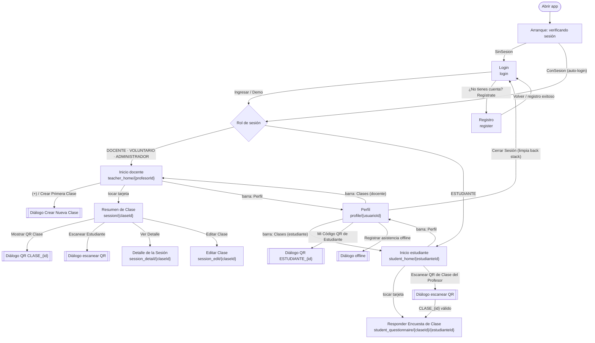

# Mockups y trazabilidad visual — SyncPass (Android)

> **Corte:** 2026-11-19. Los wireframes se derivaron de los `@Composable` reales de `app/src/main/java/com/example/syncpassapp/` (rutas de archivo relativas a ese paquete); no son un rediseño. No se adjuntan capturas porque no se contó con emulador. Los textos dentro de los recuadros y entre «comillas» son los literales del código, incluidas sus faltas de tilde (por ejemplo «camara» y «codigo» en `QrComponents.kt`). `<...>` indica un dato dinámico.

## 1. Qué parte de la UI llega al backend

La app tiene dos modelos de datos en Room que conviven sin mezclarse. Conviene leer esto antes que los wireframes:

| Zona de la UI | Datos que usa | ¿Llega al backend? |
|---|---|---|
| Login, Registro | `AuthApi`: `POST api/auth/login`, `POST api/auth/registro` (Cognito detrás del backend) | **Sí** |
| Inicio docente, Resumen / Detalle / Editar clase, Inicio estudiante, Cuestionario | Modelo local «Universidad»: tablas Room `usuarios`, `roles`, `clases`, `asistencia_clase` (Clase / Profesor / Estudiante) | **No.** Solo existen en el teléfono; ningún endpoint las recibe |
| Perfil: tarjeta de usuario y «Mi Código QR de Estudiante» | Usuario local de Room + rol de la sesión (leído del token) | No (el QR codifica el `usuarioId` local) |
| Perfil: sección «Sincronización» + diálogo «Registrar asistencia offline» | Catálogo remoto guardado en Room (`proyectos`, `eventos`, `participantes`, `inscripciones`) y pendientes (`asistencias`, `encuestas`) | **Sí:** `GET api/sync/catalogo`, `POST api/sync/asistencias`, `POST api/sync/encuestas` |
| Sin vista: reintento automático | `SyncPassApplication` registra un `NetworkCallback`; cuando vuelve una red con internet validado llama a `SyncRepository.sincronizarPendientes()` | **Sí** |

En resumen: **el único flujo de negocio que hoy sincroniza con el backend es la sección «Sincronización» del Perfil** (Descargar catálogo → Registrar asistencia offline → Sincronizar pendientes), más el reintento automático al recuperar la red. Las pantallas de clases, QR de clase y cuestionario son un flujo local-first que no lee ni alimenta los eventos del backend.

## 2. Roles y navegación

### 2.1 Rol de la sesión

`core/common/auth/Rol.kt` traduce los grupos de Cognito del token a los perfiles de la rúbrica:

| Grupo Cognito | `Rol` | Inicio al entrar | Texto en Perfil |
|---|---|---|---|
| `BENEFICIARIO` | `ESTUDIANTE` | Inicio estudiante (`StudentHomeScreen`) | «Rol: Estudiante» |
| `COORDINADOR` | `DOCENTE` | Inicio docente (`TeacherHomeScreen`) | «Rol: Docente» |
| `VOLUNTARIO` | `VOLUNTARIO` | Inicio docente (`TeacherHomeScreen`) | «Rol: Voluntario» |
| `ADMINISTRADOR` | `ADMINISTRADOR` | Inicio docente (`TeacherHomeScreen`) | «Rol: Administrador» |

- Con varios grupos manda el de mayor prioridad: Administrador > Docente > Voluntario > Estudiante. Sin grupos reconocidos se trata como Estudiante. También acepta los nombres antiguos de la app (`PROFESOR`, `ESTUDIANTE`, `ADMIN`).
- Docente, Voluntario y Administrador ven **las mismas pantallas**: dentro del personal no hay vistas distintas por rol (las métricas para Administrador están en el backlog, sección 7).
- No hay vista de «acceso denegado»: el rol solo decide a qué inicio se entra.

### 2.2 Flujo de navegación



Reglas que aplica el código:

- Todas las rutas están en `core/common/navigation/Destino.kt` (sealed class): `login`, `register`, `teacher_home/{profesorId}`, `student_home/{estudianteId}`, `session/{claseId}`, `session_detail/{claseId}`, `session_edit/{claseId}`, `student_questionnaire/{claseId}/{estudianteId}`, `profile/{usuarioId}`.
- Al iniciar sesión, `login` se saca del back stack (`popUpTo(login) { inclusive = true }`). «Cerrar Sesión» navega a `login` con `popUpTo(0)`, así que no se puede volver atrás.
- Las pantallas secundarias (Resumen, Detalle, Editar, Cuestionario) usan `PantallaConBarraSuperior`: `TopAppBar` con título y flecha «Volver» (`popBackStack`). No muestran barra inferior.
- El cambio de pestaña usa `navegarAPestana` (guarda y restaura el estado de cada pestaña, `launchSingleTop`).

### 2.3 Barra inferior (`MainActivity.kt`)

```text
├──────────────────────────────────────────────────┤
│           ⌂ Clases           ☺ Perfil            │
└──────────────────────────────────────────────────┘
```

- «Clases» (ícono Home) lleva al inicio que corresponde al rol; «Perfil» (ícono Person) a `profile/{usuarioId}`. La pestaña activa queda resaltada (`selected`).
- Solo aparece en Inicio docente, Inicio estudiante y Perfil. Se oculta en Login, Registro y en las pantallas con flecha «Volver».
- La pestaña se llama «Clases» para todos los roles.

## 3. Convenciones de los wireframes

| Símbolo | Componente Compose |
|---|---|
| `[ Texto ]` | `Button` (relleno) |
| `( Texto )` | `OutlinedButton` |
| `‹ Texto ›` | `TextButton` |
| `▭ Etiqueta ____` | `OutlinedTextField` (la etiqueta va dentro del campo) |
| `⟦Texto⟧` / `⟨Texto⟩` | `FilterChip` seleccionado (fondo relleno) / no seleccionado |
| `◉` / `○` | `RadioButton` marcado / sin marcar |
| `☑` / `☐` | `Checkbox` marcado / sin marcar |
| `◌` | `CircularProgressIndicator` |
| `(+)` | `FloatingActionButton` (ícono Add) |
| `←` | flecha «Volver» de la `TopAppBar` |
| `┄┄┄` | `HorizontalDivider` |
| `ⓘ` `⇪` `☺` `✎` `⌂` | íconos Info, Share, Person, Edit y Home |
| `┌ nombre ─┐` dentro de la pantalla | `Card` / `TarjetaSeccion` / `TarjetaClase`; el nombre indica el color de contenedor cuando cambia según el estado |

## 4. Vistas

### 4.1 Arranque: restauración de sesión (`MainActivity.kt`, `AppNavegacion`)

```text
┌──────────────────────────────────────────────────┐
│                                                  │
│                                                  │
│                        ◌                         │
│                                                  │
│                                                  │
└──────────────────────────────────────────────────┘
```

- Se ve mientras `SesionViewModel` está en `Verificando`.
- `SinSesion` (sin token, token vencido o usuario no existe en Room) → Login. `ConSesion` → inicio según el `Rol` (auto-login, sin pasar por Login).
- Con sesión y Android 13 o superior, el sistema muestra su diálogo de permiso de notificaciones (`POST_NOTIFICATIONS`).

### 4.2 Login: `login` (`feature/auth/ui/LoginScreen.kt`)

```text
┌──────────────────────────────────────────────────┐
│                                                  │
│                    SyncPass                      │
│                 Iniciar Sesión                   │
│ ┌──────────────────────────────────────────────┐ │
│ │ ▭ Correo o Usuario                           │ │
│ │ ▭ Contraseña                        (oculta) │ │
│ │ [                 Ingresar                 ] │ │
│ │ (   Demo Profesor   ) (   Demo Alumno      ) │ │
│ │ <mensaje de error en rojo>                   │ │
│ │      ‹ ¿No tienes cuenta? Regístrate ›       │ │
│ └──────────────────────────────────────────────┘ │
│                                                  │
└──────────────────────────────────────────────────┘
```

Estados:

- **Formulario:** estado inicial. «Ingresar» también se dispara con la acción «Done» del teclado.
- **Cargando:** `◌` reemplaza a «Ingresar» y a los dos botones demo.
- **Error** (texto rojo bajo los botones): «Correo y contraseña son obligatorios.» o «Error de autenticación: <mensaje>». Escribir en cualquier campo borra el error.
- **Éxito:** navega al inicio según el `Rol` (sección 2.1) y saca Login del back stack.

Notas: «Demo Profesor» y «Demo Alumno» rellenan `profesor@syncpass.com` / `estudiante@syncpass.com` con `password123` y llaman al mismo login real, así que solo funcionan si esas cuentas existen en Cognito. No hay botón para ver la contraseña ni enlace para confirmar la cuenta.

### 4.3 Registro: `register` (`feature/auth/ui/RegisterScreen.kt`)

```text
┌──────────────────────────────────────────────────┐
│                  Crear Cuenta                    │
│ ┌──────────────────────────────────────────────┐ │
│ │ ▭ Nombre Completo                            │ │
│ │ ▭ Correo Electrónico                         │ │
│ │ ▭ Teléfono (Ej: +56912345678)                │ │
│ │ ▭ Contraseña                        (oculta) │ │
│ │ [               Registrarse                ] │ │
│ │ <error en rojo / éxito en color primario>    │ │
│ │       ‹ Volver al Inicio de Sesión ›         │ │
│ └──────────────────────────────────────────────┘ │
└──────────────────────────────────────────────────┘
```

Estados:

- **Cargando:** `◌` en lugar de «Registrarse».
- **Error de validación:** «Todos los campos son obligatorios.» o «El teléfono debe tener formato internacional E.164, por ejemplo +56912345678.»
- **Error del servidor:** «Error en registro: <mensaje>».
- **Éxito:** se fija «¡Registro exitoso! Revisa tu correo para confirmar.», pero la pantalla vuelve de inmediato al Login (`onNavigateBack`), así que en la práctica ese mensaje no alcanza a verse.
- **No existe** la etapa de confirmación del código ni «reenviar código». La API ya está en `AuthRepository.confirmarRegistro` / `reenviarCodigo`, pero ninguna pantalla la usa; hoy la cuenta se confirma por otro medio (por ejemplo, la app web).

### 4.4 Inicio docente: `teacher_home/{profesorId}` (`feature/clases/ui/TeacherHomeScreen.kt`)

Lo ven Docente, Voluntario y Administrador.

```text
┌──────────────────────────────────────────────────┐
│ Panel Docente                                    │
│ Gestión de clases y eventos SyncPass             │
│                                                  │
│ ⟦Todos⟧ ⟨🟢 En Curso⟩ ⟨🏁 Finalizados⟩           │
│                                                  │
│ ┌ TarjetaClase (surfaceVariant) ───────────────┐ │
│ │ Primer Curso                     🟢 En Curso │ │
│ │ Curso de prueba de persistencia local        │ │
│ └──────────────────────────────────────────────┘ │
│ ┌ TarjetaClase (surfaceVariant al 60 %) ───────┐ │
│ │ <nombre>                       🏁 Finalizado │ │
│ │ <descripción>                                │ │
│ └──────────────────────────────────────────────┘ │
│                                              (+) │
├──────────────────────────────────────────────────┤
│           ⌂ Clases           ☺ Perfil            │
└──────────────────────────────────────────────────┘
```

Estado **vacío** (`EstadoVacio` con acción), en lugar de la lista:

```text
│                        ⓘ                         │
│        No hay clases en esta categoría.          │
│             [ Crear Primera Clase ]              │
```

- Los chips filtran por `estado` de la clase: Todos / `EN_CURSO` / `FINALIZADO`. Tocar una tarjeta abre el Resumen de Clase.
- No hay estado de carga explícito: la lista parte vacía y se llena cuando Room emite (puede verse el estado vacío un instante).
- Solo lista las clases locales cuyo `profesorId` es el usuario. Pese al subtítulo, **no muestra eventos del backend**.

#### Diálogo «Crear Nueva Clase» (`DialogCrearClase`, en el mismo archivo)

```text
┌──────────────────────────────────────────────────┐
│ Crear Nueva Clase                                │
│                                                  │
│ ▭ Nombre de la Clase                             │
│ ▭ Descripción                                    │
│ Estado Inicial:                                  │
│ ◉ En Curso      ○ Finalizado                     │
│ ▭ Cuestionario Estructura (JSON)                 │
│   {"preguntas":["¿Asististe a la sesión?",       │
│   "¿Tienes alguna duda?"]}                       │
│                                                  │
│                          ‹ Cancelar ›  [ Crear ] │
└──────────────────────────────────────────────────┘
```

- Se abre con el FAB `(+)` o con «Crear Primera Clase».
- «Crear» está deshabilitado mientras el nombre esté vacío. Al crear se guarda en Room con el usuario como profesor, el diálogo se cierra y la lista se actualiza sola (Flow).
- El JSON del cuestionario es texto libre: no se valida.

### 4.5 Resumen de Clase: `session/{claseId}` (`feature/clases/ui/SessionScreen.kt`)

```text
┌──────────────────────────────────────────────────┐
│ ←  Resumen de Clase                              │
├──────────────────────────────────────────────────┤
│ ┌ primaryContainer ────────────────────────────┐ │
│ │ <nombre de la clase>                         │ │
│ │ <descripción>                                │ │
│ │ Profesor a Cargo: <nombre>                   │ │
│ └──────────────────────────────────────────────┘ │
│ ┌ secondaryContainer ──────────────────────────┐ │
│ │ Opciones QR de la Clase                      │ │
│ │ [⇪ Mostrar QR Clase] [☺ Escanear Estudiante] │ │
│ └──────────────────────────────────────────────┘ │
│ ┌──────────────────────────────────────────────┐ │
│ │ Estructura del Cuestionario (JSON)           │ │
│ │ ┄┄┄┄┄┄┄┄┄┄┄┄┄┄┄┄┄┄┄┄┄┄┄┄┄┄┄┄┄┄┄┄┄┄┄┄┄┄┄┄┄┄┄┄ │ │
│ │ {"preguntas":["¿Asististe a la clase?", …]}  │ │
│ └──────────────────────────────────────────────┘ │
│ ┌──────────────────────────────────────────────┐ │
│ │ Estudiantes e Inscripciones                  │ │
│ │ Total inscritos: <n>                         │ │
│ └──────────────────────────────────────────────┘ │
│ [    ⓘ Ver Detalle    ] (    ✎ Editar Clase    ) │
└──────────────────────────────────────────────────┘
```

Estados y comportamiento:

- **Cargando:** solo la línea «Cargando información de la clase...». También queda así si el `claseId` no existe: no hay estado de error.
- «Total inscritos» cuenta las filas de `asistencia_clase` de la clase (inscritos presentes y ausentes).
- «Mostrar QR Clase» abre el diálogo de 4.11 con título «Código QR de la Clase» y contenido `CLASE_{claseId}`.
- «Escanear Estudiante» abre el diálogo de 4.12 con título «Escanear QR de Estudiante», prompt «Apunta la cámara al código QR que muestra el estudiante en su perfil.» y el campo **prellenado con `ESTUDIANTE_2`** (atajo de demo: si se pulsa «Procesar QR» sin escanear, se marca al usuario local 2).
  - QR válido → Toast «¡Estudiante {id} marcado como PRESENTE!» y el diálogo se cierra. Se guarda en Room con `esPresente = true` y respuestas en null; como el insert es `REPLACE`, si el estudiante ya había respondido, sus respuestas se pierden.
  - QR inválido → Toast «Código QR inválido. Formato esperado: ESTUDIANTE_{id}». El diálogo sigue abierto.
- Contenido con scroll vertical. Sin barra inferior.

### 4.6 Detalle de la Sesión: `session_detail/{claseId}` (`feature/clases/ui/SessionDetailScreen.kt`)

```text
┌──────────────────────────────────────────────────┐
│ ←  Detalle de la Sesión                          │
├──────────────────────────────────────────────────┤
│ <nombre de la clase>                             │
│ Respuestas y Asistencias de la Clase             │
│                                                  │
│ ┌ primaryContainer (presente) ─────────────────┐ │
│ │ Estudiante: <nombre>                         │ │
│ │ Email: <correo>                              │ │
│ │ ┄┄┄┄┄┄┄┄┄┄┄┄┄┄┄┄┄┄┄┄┄┄┄┄┄┄┄┄┄┄┄┄┄┄┄┄┄┄┄┄┄┄┄┄ │ │
│ │ Asistencia: PRESENTE                         │ │
│ │ Respuestas Cuestionario (JSON):              │ │
│ │ {"respuestas":["…", "…"]}                    │ │
│ └──────────────────────────────────────────────┘ │
│ ┌ errorContainer (ausente) ────────────────────┐ │
│ │ Estudiante: <nombre>                         │ │
│ │ Email: <correo>                              │ │
│ │ ┄┄┄┄┄┄┄┄┄┄┄┄┄┄┄┄┄┄┄┄┄┄┄┄┄┄┄┄┄┄┄┄┄┄┄┄┄┄┄┄┄┄┄┄ │ │
│ │ Asistencia: AUSENTE                          │ │
│ └──────────────────────────────────────────────┘ │
└──────────────────────────────────────────────────┘
```

Estados:

- **Cargando:** «Cargando detalle de sesión...».
- **Vacío:** «No hay registros de asistencia para esta clase.» (texto simple, no usa `EstadoVacio`).
- **Lista:** tarjeta `primaryContainer` si está PRESENTE y `errorContainer` si está AUSENTE. Mientras no carga el usuario, el nombre se muestra como «ID <n>». El bloque «Respuestas Cuestionario (JSON):» solo aparece si hay respuestas, y se muestran como JSON crudo.

### 4.7 Editar Clase: `session_edit/{claseId}` (`feature/clases/ui/SessionEditScreen.kt`)

```text
┌──────────────────────────────────────────────────┐
│ ←  Editar Clase                                  │
├──────────────────────────────────────────────────┤
│ ▭ Nombre de la Clase                             │
│ ▭ Descripción                                    │
│ ▭ Estructura Cuestionario (JSON)                 │
│ [               Guardar Cambios                ] │
└──────────────────────────────────────────────────┘
```

Estados:

- **Cargando:** «Cargando información para edición...».
- **Error:** «No se pudo cargar la clase.» (el `claseId` no existe).
- **Éxito:** «Guardar Cambios» actualiza Room y vuelve atrás.
- No valida el nombre vacío y **no tiene campo de estado**: una clase no se puede finalizar después de crearla.

### 4.8 Inicio estudiante: `student_home/{estudianteId}` (`feature/asistencia/ui/StudentHomeScreen.kt`)

```text
┌──────────────────────────────────────────────────┐
│ Mis Cursos y Encuestas                           │
│ Bienvenido/a, <nombre>                           │
│ [     ⇪ Escanear QR de Clase del Profesor      ] │
│                                                  │
│ ┌ TarjetaClase (primaryContainer) ─────────────┐ │
│ │ Primer Curso                        PRESENTE │ │
│ │ <descripción>                                │ │
│ │ Encuesta respondida ✓                        │ │
│ └──────────────────────────────────────────────┘ │
│ ┌ TarjetaClase (surfaceVariant) ───────────────┐ │
│ │ <nombre>                           PENDIENTE │ │
│ │ <descripción>                                │ │
│ │ Toca para responder encuesta de clase ->     │ │
│ └──────────────────────────────────────────────┘ │
├──────────────────────────────────────────────────┤
│           ⌂ Clases           ☺ Perfil            │
└──────────────────────────────────────────────────┘
```

Estado **vacío** (`EstadoVacio` sin acción), en lugar de la lista:

```text
│                        ⓘ                         │
│No estás inscrito/a en ninguna clase actualmente. │
```

- Lista las clases locales en las que el usuario tiene fila en `asistencia_clase`. «PRESENTE» va en color primario y «PENDIENTE» en color de error. Tocar una tarjeta abre el Cuestionario.
- «Bienvenido/a, <nombre>» aparece cuando carga el usuario. No hay estado de carga explícito (la lista parte vacía).
- «Escanear QR de Clase del Profesor» abre el diálogo de 4.12 con título «Escanear QR de Clase», prompt «Apunta la cámara al código QR de la clase que muestra tu profesor.» y el campo **prellenado con `CLASE_1`**.
  - QR válido → cierra el diálogo y abre el Cuestionario de esa clase, aunque el estudiante no esté inscrito en ella.
  - QR inválido → Toast «Código QR de clase inválido. Formato esperado: CLASE_{id}».

### 4.9 Responder Encuesta de Clase: `student_questionnaire/{claseId}/{estudianteId}` (`feature/asistencia/ui/StudentQuestionnaireScreen.kt`)

```text
┌──────────────────────────────────────────────────┐
│ ←  Responder Encuesta de Clase                   │
├──────────────────────────────────────────────────┤
│ ┌──────────────────────────────────────────────┐ │
│ │ <nombre de la clase>                         │ │
│ │ <descripción>                                │ │
│ │ Profesor: <nombre>                           │ │
│ └──────────────────────────────────────────────┘ │
│ ┌──────────────────────────────────────────────┐ │
│ │ ☑ Marcar como PRESENTE en esta sesión        │ │
│ │ ┄┄┄┄┄┄┄┄┄┄┄┄┄┄┄┄┄┄┄┄┄┄┄┄┄┄┄┄┄┄┄┄┄┄┄┄┄┄┄┄┄┄┄┄ │ │
│ │ Estructura Cuestionario (JSON):              │ │
│ │ {"preguntas":["¿Asististe a la clase?", …]}  │ │
│ │                                              │ │
│ │ Pregunta 1: ¿Asististe a la clase de hoy?    │ │
│ │ ▭ Respuesta 1                                │ │
│ │ Pregunta 2: ¿Qué aprendiste hoy?             │ │
│ │ ▭ Respuesta 2                                │ │
│ └──────────────────────────────────────────────┘ │
│ [        Guardar Encuesta y Asistencia         ] │
└──────────────────────────────────────────────────┘
```

Estado **no presente** (checkbox `☐`): en lugar de las dos preguntas aparece, en rojo:

```text
│ │ Debes marcarte como PRESENTE para responder  │ │
│ │ el cuestionario de esta clase.               │ │
```

Estados y comportamiento:

- **Cargando:** «Cargando encuesta de la clase...».
- **Éxito:** «Guardar Encuesta y Asistencia» guarda en Room asistencia y respuestas (solo si está presente) y vuelve atrás. El botón también está activo en el estado «no presente»: en ese caso guarda `esPresente = false` sin respuestas.
- Las dos preguntas están **fijas en el código**: el JSON de estructura solo se muestra como texto, no genera el formulario.
- Las respuestas vienen **prellenadas** («Sí, asistí a la sesión de hoy» y «Aprendí el funcionamiento de las entidades de Room») y el checkbox parte marcado.
- Si ya existe una fila de asistencia para ese estudiante y clase, el checkbox muestra el valor guardado y **no se puede cambiar** (el ViewModel prioriza el valor de Room sobre el del checkbox). Un estudiante inscrito como ausente ve el aviso rojo y no puede marcarse presente desde aquí.
- Si la clase llegó por QR y el estudiante no estaba inscrito, guardar crea la fila en `asistencia_clase`, es decir, lo inscribe implícitamente.
- Nada de esto se envía al backend.

### 4.10 Perfil: `profile/{usuarioId}` (`feature/perfil/ui/ProfileScreen.kt`)

```text
┌──────────────────────────────────────────────────┐
│                Perfil de Usuario                 │
│ ┌──────────────────────────────────────────────┐ │
│ │                 ☺ (avatar)                   │ │
│ │                  <nombre>                    │ │
│ │                  <correo>                    │ │
│ │ ┄┄┄┄┄┄┄┄┄┄┄┄┄┄┄┄┄┄┄┄┄┄┄┄┄┄┄┄┄┄┄┄┄┄┄┄┄┄┄┄┄┄┄┄ │ │
│ │               Rol: Voluntario                │ │
│ │ (       ⇪ Mi Código QR de Estudiante       ) │ │
│ └──────────────────────────────────────────────┘ │
│               ↕ espacio flexible                 │
│ [                Cerrar Sesión                 ] │
│ ┄┄┄┄┄┄┄┄┄┄┄┄┄┄┄┄┄┄┄┄┄┄┄┄┄┄┄┄┄┄┄┄┄┄┄┄┄┄┄┄┄┄┄┄┄┄┄┄ │
│                 Sincronización                   │
│     Pendientes: 2 asistencias, 0 encuestas       │
│ [            Sincronizar pendientes            ] │
│           Sincronización completada.             │
│  Aceptados: 2 · Duplicados: 0 · Rechazados: 0    │
│ (         Registrar asistencia offline         ) │
│ (              Descargar catálogo              ) │
├──────────────────────────────────────────────────┤
│           ⌂ Clases           ☺ Perfil            │
└──────────────────────────────────────────────────┘
```

Tarjeta de usuario:

- Nombre y correo salen del usuario local de Room. «Rol: <Estudiante | Docente | Voluntario | Administrador>» es el rol de la sesión (`Rol`, sección 2.1), leído del token. Mientras se lee la sesión, se muestran por un instante los roles locales («Profesor»/«Estudiante»).
- «Cerrar Sesión» (botón rojo, `colorScheme.error`) detiene las notificaciones, borra los tokens y vuelve a Login limpiando el back stack.
- «Mi Código QR de Estudiante» abre el diálogo de 4.11 con título «Mi Código QR de Estudiante», subtítulo «Muestra este código al profesor durante la clase para registrar tu asistencia.» y contenido `ESTUDIANTE_{usuarioId local}`. Se muestra para todos los roles, también para el personal.
- **Cargando:** «Cargando perfil...» reemplaza a la tarjeta y a «Cerrar Sesión». La sección de sincronización se ve igual.

Sección «Sincronización» (la única que habla con el backend, vía `SyncViewModel`):

| Estado | Qué se ve |
|---|---|
| Reposo | «Pendientes: <n> asistencias, <m> encuestas» (contadores reactivos desde Room) |
| Sincronizando | «Sincronizar pendientes» deshabilitado con `◌` pequeño a la izquierda; los otros dos botones también se deshabilitan |
| Descargando catálogo | El botón dice «Descargando catálogo...» y queda deshabilitado, junto con los otros dos |
| Éxito (color primario) | «Sincronización completada.», «No hay registros pendientes.», «Catálogo descargado correctamente.» o «Asistencia guardada como pendiente.», siempre seguido de la línea «Aceptados: n · Duplicados: n · Rechazados: n» (con los valores de la última sincronización, aunque el mensaje sea de otra acción) |
| Error (rojo) | «<mensaje>. Los registros pendientes se conservan.» o «Error de red. Los registros pendientes se conservan.» al sincronizar; «<mensaje>» o «No se pudo descargar el catálogo.» al descargar |
| Reintento automático | No tiene indicador propio: cuando vuelve la red, `SyncPassApplication` sube los pendientes en segundo plano y solo se nota porque baja el contador «Pendientes» |

Notas: el contador de encuestas siempre queda en 0 desde la UI, porque ninguna pantalla crea encuestas pendientes. La columna no tiene scroll, así que en pantallas bajas la parte inferior (mensaje y últimos botones) puede quedar cortada.

### 4.11 Diálogo «Mostrar QR» (`core/designsystem/components/QrComponents.kt`, `DialogMostrarQr`)

```text
┌──────────────────────────────────────────────────┐
│ <título>                                         │
│              <subtítulo centrado>                │
│                                                  │
│            ┌──────────────────────┐              │
│            │ ▓▓▓ ▓ ▓▓  ▓▓▓ ▓  ▓▓▓ │              │
│            │ ▓ ▓  ▓▓ QR 220dp ▓ ▓ │              │
│            │ ▓▓▓ ▓  ▓▓ ▓ ▓▓▓  ▓▓▓ │              │
│            └──────────────────────┘              │
│            Codigo de datos: CLASE_1              │
│                                       [ Cerrar ] │
└──────────────────────────────────────────────────┘
```

- El QR se genera con ZXing (`generarBitmapQr`, 512 px, se muestra a 220 dp). El texto «Codigo de datos: …» repite el contenido para depurar.
- **Error:** si ZXing falla, en lugar de la imagen aparece «No se pudo generar el codigo QR» en rojo.
- Se usa en dos lugares: QR de clase (`CLASE_{claseId}`, desde Resumen de Clase) y QR del usuario (`ESTUDIANTE_{usuarioId}`, desde Perfil).

### 4.12 Diálogo «Escanear QR» (`QrComponents.kt`, `DialogEscanearQr` + `CamaraEscanerQr`)

```text
┌──────────────────────────────────────────────────┐
│ <título>                                         │
│                <prompt centrado>                 │
│            ┌──────────────────────┐              │
│            │ vista previa cámara  │              │
│            │ trasera, 220 dp      │              │
│            └──────────────────────┘              │
│    Apunta la camara al codigo QR. El codigo      │
│       detectado se carga automaticamente.        │
│ ▭ Contenido QR Escaneado                         │
│                    ‹ Cancelar ›  [ Procesar QR ] │
└──────────────────────────────────────────────────┘
```

Estado **sin permiso de cámara**, en lugar de la vista previa:

```text
│  Se necesita permiso de camara para escanear.    │
│              [ Conceder permiso ]                │
```

- CameraX + ML Kit: el primer código con contenido se copia al campo «Contenido QR Escaneado». El campo es editable, así que sirve como entrada manual.
- «Procesar QR» está deshabilitado si el campo está vacío. La validación (prefijo `CLASE_` o `ESTUDIANTE_` más número, en `core/common/qr/CodigoQr.kt`) y los Toast los hace la pantalla que abrió el diálogo (4.5 y 4.8).
- El permiso de cámara se pide automáticamente al abrir el diálogo.

### 4.13 Diálogo «Registrar asistencia offline» (`feature/sync/ui/DialogRegistrarAsistenciaOffline.kt`)

```text
┌──────────────────────────────────────────────────┐
│ Registrar asistencia offline                     │
│                                                  │
│ Se guardará como pendiente de sincronización.    │
│ Elige el evento y el participante del catálogo   │
│ remoto:                                          │
│ (         Evento: <nombre del evento>          ) │
│ (            Participante: <alias>             ) │
│                                                  │
│              ‹ Cancelar ›  [ Guardar pendiente ] │
└──────────────────────────────────────────────────┘
```

Cada selector abre un `DropdownMenu`:

```text
│ (            Participante: <alias>             ) │
│   ┌───────────────────────────────┐              │
│   │ <alias> (ESTUDIANTE)          │              │
│   │ <alias> (DOCENTE)             │              │
│   └───────────────────────────────┘              │
```

Estados:

- **Sin catálogo:** el segundo texto cambia a «Descarga el catálogo para poder registrar asistencias.», los selectores muestran «Evento: Evento» / «Participante: Participante» deshabilitados y «Guardar pendiente» queda deshabilitado.
- **Con catálogo:** se preseleccionan el primer evento y el primer participante. La lista de participantes es el catálogo completo: no se filtra por inscripción al evento.
- **Éxito:** se guarda una `AsistenciaEntity` con `sincronizado = false`, `estadoValidacion = SIN_UBICACION` y latitud, longitud y distancia en null (no hay GPS). El diálogo se cierra y el Perfil muestra «Asistencia guardada como pendiente.».

### 4.14 Notificaciones del sistema (fuera de Compose; `feature/notificaciones/NotificationService.kt`)

```text
┌──────────────────────────────────────────────────┐
│ ⓘ Notificaciones activas                         │
│   Escuchando notificaciones push                 │
├──────────────────────────────────────────────────┤
│ ⓘ <title del aviso | «Nueva notificación»>       │
│   <message del aviso>                            │
└──────────────────────────────────────────────────┘
```

- La primera es la notificación fija del servicio en primer plano. La segunda es cada aviso recibido por ntfy (SSE). Existen mientras haya sesión.
- No hay bandeja ni historial de notificaciones dentro de la app.

## 5. Estados compartidos y matriz de estados

`core/designsystem/components/Estados.kt` define un solo componente compartido, `EstadoVacio`: ícono Info de 56 dp, texto centrado y una acción opcional.

```text
│                        ⓘ                         │
│                <texto centrado>                  │
│               [ acción opcional ]                │
```

No hay componentes compartidos de carga ni de error: cada pantalla usa su propio `Text` («Cargando…») o `◌`, y los errores van como texto rojo o Toast. **No existen** un aviso de «sin conexión», Snackbars ni una vista de «acceso denegado».

| Vista | Carga | Vacío | Error | Éxito / confirmación |
|---|---|---|---|---|
| Arranque | `◌` centrado | — | — (sin sesión → Login) | entra al inicio del rol |
| Login | `◌` en lugar de los botones | — | texto rojo | navega al inicio del rol |
| Registro | `◌` en lugar del botón | — | texto rojo (validación / servidor) | vuelve a Login (el mensaje no alcanza a verse) |
| Inicio docente | — | `EstadoVacio` + «Crear Primera Clase» | — | la lista se actualiza sola |
| Crear Nueva Clase | — | — | «Crear» deshabilitado sin nombre | se cierra el diálogo |
| Resumen de Clase | «Cargando información de la clase...» | «Total inscritos: 0» | Toast QR inválido | Toast «¡Estudiante {id} marcado como PRESENTE!» |
| Detalle de la Sesión | «Cargando detalle de sesión...» | «No hay registros de asistencia para esta clase.» | — | — |
| Editar Clase | «Cargando información para edición...» | — | «No se pudo cargar la clase.» | vuelve atrás |
| Inicio estudiante | — | `EstadoVacio` «No estás inscrito/a…» | Toast QR de clase inválido | abre el Cuestionario |
| Cuestionario | «Cargando encuesta de la clase...» | — | aviso rojo «Debes marcarte como PRESENTE…» | vuelve atrás |
| Perfil | «Cargando perfil...» | «Pendientes: 0 asistencias, 0 encuestas» | mensaje rojo de sync | mensaje en color primario + contadores |
| Diálogo offline | — | «Descarga el catálogo…» + selectores deshabilitados | — | «Asistencia guardada como pendiente.» (en Perfil) |
| Diálogo Mostrar QR | — | — | «No se pudo generar el codigo QR» | — |
| Diálogo Escanear QR | — | — | sin permiso: «Se necesita permiso de camara para escanear.» | el código detectado se carga en el campo |

## 6. Trazabilidad vista → archivo → requisito → estado

Los requisitos son los RF/RNF/CU de `docs/ALCANCE.md`. «(local)» significa que la vista funciona completa pero solo con el modelo «Universidad» de Room y no llega al backend (sección 1).

| # | Vista | Archivo `.kt` | Requisito | Estado | Qué falta |
|---|---|---|---|---|---|
| 1 | Arranque / restauración de sesión | `MainActivity.kt` (`AppNavegacion`), `feature/auth/ui/SesionViewModel.kt` | RF-03 | Implementada | — |
| 2 | Login | `feature/auth/ui/LoginScreen.kt` | RF-01, CU-01 | Implementada | Ver contraseña y enlace «confirmar cuenta». Los botones demo dependen de que las cuentas existan en Cognito |
| 3 | Registro | `feature/auth/ui/RegisterScreen.kt` | RF-02 | Parcial | Etapa de confirmación de código y reenvío (API lista, sin pantalla). El mensaje de éxito no se ve |
| 4 | Barra inferior | `MainActivity.kt` | CU-01 (home según rol) | Implementada | Misma pestaña «Clases» para todos los roles |
| 5 | Inicio docente (Panel Docente) | `feature/clases/ui/TeacherHomeScreen.kt` | RF-04 | Implementada (local) | Mostrar eventos del backend. Voluntario y Administrador no tienen vistas propias |
| 6 | Diálogo «Crear Nueva Clase» | `feature/clases/ui/TeacherHomeScreen.kt` (`DialogCrearClase`) | RF-04 | Implementada (local) | Validar el JSON del cuestionario |
| 7 | Resumen de Clase | `feature/clases/ui/SessionScreen.kt` | RF-04, RF-06, RF-07 | Implementada (local) | El QR escaneado es el `usuarioId` local, no el `participanteId`. Quitar el prellenado `ESTUDIANTE_2`. Marcar presente borra respuestas previas |
| 8 | Detalle de la Sesión | `feature/clases/ui/SessionDetailScreen.kt` | RF-07, RF-08 | Implementada (local) | Las respuestas se ven como JSON crudo |
| 9 | Editar Clase | `feature/clases/ui/SessionEditScreen.kt` | RF-04 | Parcial | Cambiar el estado (finalizar clase) y validar nombre vacío |
| 10 | Inicio estudiante | `feature/asistencia/ui/StudentHomeScreen.kt` | RF-05, RF-06 | Implementada (local) | Mostrar eventos del backend. Quitar el prellenado `CLASE_1` |
| 11 | Responder Encuesta de Clase | `feature/asistencia/ui/StudentQuestionnaireScreen.kt` | RF-07, RF-08 | Parcial | Preguntas generadas desde el JSON, sin respuestas prellenadas, checkbox editable cuando ya hay registro. No sincroniza (ver backlog: encuesta post-evento) |
| 12 | Perfil: tarjeta de usuario | `feature/perfil/ui/ProfileScreen.kt`, `feature/perfil/ui/ProfileViewModel.kt` | RF-13, RF-03 (logout) | Implementada | El QR usa el id local. El botón QR también aparece para el personal. Sin scroll |
| 13 | Perfil: sección «Sincronización» | `feature/perfil/ui/ProfileScreen.kt`, `feature/sync/ui/SyncViewModel.kt` | RF-09, RF-10, RF-11, CU-04, CU-05 | Implementada | Aviso «sin conexión». Indicar cuándo corrió el reintento automático |
| 14 | Diálogo «Registrar asistencia offline» | `feature/sync/ui/DialogRegistrarAsistenciaOffline.kt` | RF-10, CU-04 | Implementada | Sin QR ni GPS (`SIN_UBICACION`, RF-14). No filtra participantes por inscripción |
| 15 | Diálogo «Mostrar QR» | `core/designsystem/components/QrComponents.kt` (`DialogMostrarQr`) | RF-06, RF-13 | Implementada | — |
| 16 | Diálogo «Escanear QR» + cámara | `core/designsystem/components/QrComponents.kt` (`DialogEscanearQr`, `CamaraEscanerQr`) | RF-06, RNF-05 | Implementada | — |
| 17 | Estado vacío compartido | `core/designsystem/components/Estados.kt` | RNF-08 (coherencia UI) | Implementada | Componentes compartidos de carga y error |
| 18 | Notificaciones del sistema | `feature/notificaciones/NotificationService.kt` | RF-12, RNF-05 | Parcial | Bandeja o historial dentro de la app |
| 19 | Inscripción de estudiantes (sin vista propia) | `core/database/repository/UniversidadRepository.kt` | RF-05 | Parcial | No hay pantalla para inscribir. La fila solo se crea con los datos demo del primer login, al escanear el QR del estudiante o al guardar el cuestionario |
| — | Reintento automático (sin vista) | `SyncPassApplication.kt` | RNF-04 | Implementada | Feedback visual (ver backlog) |

## 7. Backlog visual

Vistas que **no existen** en el entregable actual y están planificadas (de `docs/ALCANCE.md` §5 y brechas conocidas):

| # | Vista planificada | Requisito | Qué mostraría | Base que ya existe en el código |
|---|---|---|---|---|
| B1 | Catálogo de cursos y eventos navegable | RF-09 (uso del catálogo) | Lista de proyectos → eventos (fecha, recinto, cupos) leída desde Room, también sin conexión | `ProyectoEntity`, `EventoEntity` e `InscripcionEntity` ya se guardan con «Descargar catálogo». Hoy solo se ven como opciones del selector «Evento» del diálogo offline |
| B2 | Registro de asistencia por QR + GPS contra eventos del backend | RF-10, RF-14 | Escanear el QR del participante dentro de un evento, medir la distancia al recinto y fijar `estadoValidacion` | `AsistenciaEntity` ya tiene `latitud`, `longitud`, `distanciaMetros` y `estadoValidacion`. `EventoEntity` trae `latitud`, `longitud` y `radioMetros`. `DialogEscanearQr` es reutilizable. Hoy todo se guarda como `SIN_UBICACION` |
| B3 | Encuesta post-evento del backend (satisfacción y utilidad 1–5 + comentario) | RF-08 (reemplazo) | Formulario que crea una encuesta pendiente y la sincroniza; reemplaza al cuestionario local de 4.9 | `EncuestaEntity`, `SyncRepository.registrarEncuestaLocal` y `POST api/sync/encuestas` existen, pero ninguna vista los usa |
| B4 | «Mi QR» del estudiante con su `participanteId` | RF-13 | QR con el identificador de participante del backend | Hoy `DialogMostrarQr` muestra `ESTUDIANTE_{usuarioId local}`, que el backend no reconoce |
| B5 | Métricas del evento para Administrador | — (sin RF en `ALCANCE.md`) | Asistentes, quórum y resultados de encuestas por evento | `EventoApi.metricasEvento` (`GET api/eventos/{id}/metricas`) y `MetricasEventoDto` declarados, sin ViewModel ni pantalla |
| B6 | Aviso «sin conexión» en la UI | RNF-04 | Banner o Snackbar global sin red, y aviso cuando el reintento automático sube pendientes | `SyncPassApplication` ya escucha la red, pero no expone ese estado a la UI |
| B7 | Confirmación de cuenta (código + reenviar) | RF-02 | Segunda etapa del registro | `AuthRepository.confirmarRegistro` / `reenviarCodigo` |
| B8 | Bandeja de notificaciones | RF-12 | Historial de avisos recibidos | Hoy solo se muestran como notificaciones del sistema (4.14) |
| B9 | Gestión de inscripciones | RF-05 | Inscribir o quitar participantes de una clase o evento | `UniversidadRepository.inscribirEstudianteEnClase` (local, sin pantalla) e `InscripcionEntity` (remoto, solo lectura) |
